# M8-Phase Models — Final-Phase Reference (R*, C1–C12, VIGIL/M8, Round 2)

Per-variant reference for every model trained in the final phase (2026-11-05 onwards), with an
architecture diagram for each. The companion to [`models_summary.md`](models_summary.md), which
covers the reproduced M1–M7.

- Chronology and decisions: [`story_so_far.md`](story_so_far.md).
- Plan and schedule: [`../model_research/plan_14day.md`](../model_research/plan_14day.md).
- Round-2 research: [`../model_research/round2_research.md`](../model_research/round2_research.md).

**Common protocol (P0), unless a row says otherwise:**
- **Labels:** 3-class y3 (KSS ≤3 Alert / 4–6 LowVigilant / ≥7 Drowsy).
- **Windows:** canonical 60 s windows at a 15 s stride (`cache/windows.parquet`). The video cohort
  is 16 subjects / 4,532 windows (no video for B, I, M).
- **Folds:** subject-independent 5-fold, ABCD / EFGH / IJK / LMNO / PQRS. Inner 4-fold OOF on the
  training subjects is used for selection.
- **Runs:** 3 seeds; test probabilities are averaged over seeds.
- **Metrics:** fold-mean macro-F1 and pooled macro-F1 (all test windows concatenated).
- **Significance:** subject-level paired permutation test on pooled macro-F1 (exact, 2¹⁶).
- **Code:** in `m8/`, with entry points in `scripts/m8/`. Per-run JSONs are in `results/m8/`;
  everything is logged to wandb `m25ai2065-iitj/drowsiness_project`.

---

## 0. Results at a glance (status 2026-11-07; final evaluation in §0.5)

### 0.1 Baselines

| ID | Model | Fold-mean F1 | Pooled F1 | Notes |
|---|---|---|---|---|
| R0 | Majority / stratified random | 0.154 / 0.320 | 0.215 / 0.327 | Floor |
| **R1** | **Clock only** (LR on time-in-drive + epoch index) | **0.355** | **0.369** | The bar every model must clear (V5) |
| R1b | Clock + session label (shortcut upper bound) | 0.668 | 0.699 | Not a model; shows how much the A/D session explains |
| R4s | Honest M5 retrain (YOLOv8n-cls, 3 seeds) + window mean + EMA | 0.333 | 0.367 | Fair H1 comparator; ≈ clock |
| R6 | Tabular LR, face + telemetry window stats | 0.28–0.36 | 0.32–0.40 | ≈ clock |
| R7 | Image-statistics shortcut probe | 0.306 | 0.356 | No brightness/colour shortcut |

### 0.2 Single streams and heads (C1–C5)

Frozen DINOv2-S. The token is `cls_mean` (768-d) unless noted.

| Run | Stream | Head | Fold-mean | Pooled | Inner-OOF |
|---|---|---|---|---|---|
| **C1 = V\*** | **IR face 112 px, 2 fps** | **mean-pool** | **0.440** | **0.446** | 0.434 |
| C1 | IR 112 | MIL | 0.410 | 0.411 | 0.450 |
| C1 | IR 168 | MIL | 0.424 | 0.410 | 0.423 |
| C2 | L3D face 168 | mean / MIL | 0.332 / 0.326 | 0.378 / 0.373 | 0.409 / 0.385 |
| C2 | L3D 168 + R3D TTA | MIL | 0.323 | 0.364 | 0.400 |
| C3 | Pose side view 224, 1 fps | mean / MIL | 0.414 / 0.433 | 0.470 / **0.499** | 0.335 / 0.380 |
| C4 | Landmark/AU/geometry, 2 Hz | mean / MIL | 0.318 / 0.311 | 0.386 / 0.355 | 0.382 / 0.391 |
| C5 | IR 112, temporal transformer | tf | 0.411 | 0.404 | 0.430 |
| C5 | IR 112, 240 s causal context (stride 4) | mean / MIL / tf | 0.455 / 0.444 / 0.470 | 0.451 / 0.443 / 0.458 | 0.405 / 0.416 / 0.395 |
| C5 | Causal EMA / HMM smoothing on V\* | — | no gain | — | — |

### 0.3 Fusion, telemetry, gate (C6–C9) and M8

| Run | Model | Clean fold-mean / pooled | 60 s blackout fold-mean / pooled | Gate mean (clean → blackout) |
|---|---|---|---|---|
| C6 | IR + pose, equal-weight late fusion | 0.469 / 0.517 | — | — (exploratory, test-seen) |
| C6 | IR + pose, OOF-learned weights | 0.405 / 0.433 | — | — |
| C7 | Telemetry expert (14 ch, 4 Hz), mean / MIL | 0.362 / 0.341 | — | — |
| C8 | IR + telemetry late fusion, equal / learned | 0.421 / 0.306 | — | — |
| C9 | Vision only (same ModDrop) | 0.408 / 0.430 | 0.190 / 0.186 | — |
| C9 | Residual gate (telemetry) | 0.420 / 0.435 | 0.323 / 0.339 | 0.12 → 0.12 (cosmetic) |
| C9 | Late (always-on residual) | 0.417 / 0.435 | 0.321 / 0.341 | 1 |
| C9 | Residual gate (clock) | 0.413 / 0.435 | 0.282 / 0.283 | 0.11 → 0.06 |
| C9b | MoE telemetry / MoE clock (slow gate) | 0.412 / 0.412 | 0.226 / 0.190 | ≈ 0.05 → 0.17 |
| C9c | MoE telemetry, fast gate | 0.421 / 0.434 | 0.285 / 0.320 | 0.01 → 0.86 |
| C9c | MoE clock, fast gate | 0.420 / 0.435 | 0.334 / 0.371 | 0.00 → 0.86 |
| **C9d = M8** | **MoE, fallback expert = telemetry + clock, fast gate** | **0.416 / 0.428** | **0.326 / 0.349** | **0.13 → 0.93** |

- M8 vs vision-only at 60 s blackout: Δ pooled **+0.163, p = 0.076**.
- M8 under clean input: Δ −0.002 (p = 0.80), i.e. M8 does no harm.

### 0.4 Late ablations (C10–C12) and round 2

| Run | Model | Fold-mean | Pooled | Verdict |
|---|---|---|---|---|
| C10 | V\* + ordinal (cumulative-logit) loss | 0.399 | 0.404 | Negative (Δ −0.042, p = 0.10) |
| C11 | B2 binary (KSS ≤5 vs ≥6): V\* / pose MIL / clock | 0.571 / 0.506 / 0.573 | 0.569 / 0.550 / 0.566 | V\* only ties the clock |
| C12 | Same-session start-of-drive normalisation: IR / pose | 0.351 / 0.276 | 0.368 / 0.293 | Negative; removes the level signal |
| **R2-7** | **Alert-session calibration (IR 112)** | **0.500** | **0.521** | Best number; P4 protocol only (optimistic, see §4.4) |
| R2-8 | Absolute + delta (concat) calibration | 0.383 | 0.405 | Negative |
| R2-1/4 | 27 event features at 60 fps → LR | 0.440 | 0.480 | Ties V\*; LOSO 0.430 |
| R2-4 | Posture keypoint events only | 0.386 | 0.449 | Passes the session audit (0.455) |
| R2-12 | DINOv3-S/16 encoder swap (IR 112) | 0.329 | 0.325 | Negative |
| R2-2 | IR eye crops 112 px, 10 fps, mean | 0.360 | 0.385 | Negative (Δ −0.060, p = 0.17; inner 0.457) |
| R2-2 | IR eye crops, MIL | 0.367 | 0.409 | Negative (Δ −0.037, p = 0.62; inner 0.475) |
| **V1** | **LOSO V\*** (IR 112 mean) | — | **0.471** | +0.025 vs the same model under 5-fold (p = 0.30) |
| **V1** | **LOSO Alert-calibrated V\*** | — | **0.518** | +0.048 vs LOSO V\* (p = 0.44); ≈ its 5-fold 0.521 |
| V1 | LOSO pose MIL | — | 0.409 | Drops from 0.499 under 5-fold; −0.062 vs LOSO V\* |

### 0.5 Final evaluation (status 2026-11-07)

Scripts: `scripts/m8/fusion_calib_events.py` and `scripts/m8/final_metrics.py`. Outputs:
`results/m8/fusion_calA_events.json` and `results/m8/final_metrics.json`.

**Fusion, calibrated V\* + events (P4):** equal-weight log-prob averaging. The rule was fixed
before any fused number was seen.

| Label | Protocol | V\* | Calibrated V\* | Events | **Fusion** | Fusion vs calibrated |
|---|---|---|---|---|---|---|
| y3 | 5-fold | 0.446 | 0.521 | 0.480 | **0.536** | +0.016 (p 0.47) |
| y3 | LOSO | 0.471 | 0.518 | 0.430 | **0.525** | +0.006 (p 0.79) |
| B2 | 5-fold | 0.569 | **0.775** | 0.561 | 0.764 | −0.011 (p 0.43) |
| B2 | LOSO | 0.559 | **0.779** | 0.571 | 0.755 | −0.024 (p 0.09) |

**Extended checks, y3** (all pooled over the video cohort):

| Model | Pooled [CI] | Epoch F1 | QWK | D>A | Within ρ | Partial ρ \| time | vs clock |
|---|---|---|---|---|---|---|---|
| R1 clock | 0.366 [0.32, 0.41] | 0.369 | 0.19 | 0.42 | **+0.76** | +0.04 | — |
| R4s honest M5 | 0.362 | 0.363 | 0.27 | 1.00 | +0.11 | +0.35 | −0.004 (0.95) |
| V\* | 0.446 [0.36, 0.52] | 0.440 | 0.13 | 0.77 | +0.12 | +0.17 | +0.079 (0.31) |
| Pose MIL | 0.499 | 0.505 | 0.26 | 0.77 | +0.09 | +0.23 | +0.133 (0.15) |
| Events LR | 0.480 | 0.507 | 0.16 | 0.62 | +0.24 | +0.12 | +0.114 (0.07) |
| M8 clean / 60 s blackout | 0.428 / 0.349 | 0.419 / 0.359 | 0.15 / 0.19 | 0.85 / 0.62 | +0.18 / +0.46 | +0.20 / +0.13 | +0.062 / −0.017 |
| Vision-only 60 s blackout | 0.186 | 0.186 | 0.00 | 0.50 | — | −0.18 | −0.180 (0.04) |
| Calibrated V\* | 0.521 [0.44, 0.59] | 0.540 | **0.52** | 1.00 | +0.25 | **+0.63** | **+0.155 (0.01)** |
| **Calibrated V\* + events** | **0.536** [0.45, 0.61] | **0.545** | 0.52 | 1.00 | +0.32 | +0.63 | **+0.170 (<0.01)** |
| V\* LOSO | 0.471 [0.39, 0.55] | 0.481 | 0.13 | 0.77 | +0.12 | +0.14 | +0.105 (0.20) |
| Calibrated V\* LOSO | 0.518 [0.42, 0.61] | 0.526 | 0.53 | 1.00 | +0.24 | +0.63 | +0.152 (0.01) |
| Calibrated + events LOSO | 0.525 [0.44, 0.61] | 0.543 | 0.49 | 1.00 | +0.30 | +0.63 | +0.159 (0.01) |

**B2 (KSS ≤5 vs ≥6):**

| Model | Pooled [CI] | Epoch F1 | AUC | vs clock |
|---|---|---|---|---|
| R1 clock | 0.570 [0.53, 0.61] | 0.570 | 0.56 | — |
| V\* / V\* LOSO | 0.569 / 0.559 | 0.566 / 0.546 | 0.58 / 0.58 | ≈ 0 |
| Pose MIL / Events LR | 0.550 / 0.561 | 0.550 / 0.581 | 0.62 / 0.59 | ≈ 0 |
| M8 clean / 60 s blackout | 0.577 / 0.546 | 0.574 / 0.543 | 0.60 / 0.56 | ≈ 0 |
| Vision-only 60 s blackout | 0.340 | 0.340 | 0.45 | −0.230 (<0.01) |
| **Calibrated V\*** / LOSO | **0.775** [0.67, 0.87] / **0.779** | 0.786 / 0.801 | 0.86 / 0.86 | +0.205 (<0.01) |
| Calibrated + events / LOSO | 0.764 / 0.755 | 0.786 / 0.773 | 0.86 / 0.85 | +0.19 (0.01) |

**Pre-registered H1–H4** (subject-level paired permutation test, Holm-corrected): none is
significant with 16 subjects.

| Hypothesis | Δ pooled F1 | p | Holm |
|---|---|---|---|
| H1 V\* vs R4s | +0.084 | 0.152 | 0.456 |
| H2 M8 vs vision-only, clean (do no harm) | −0.002 | 0.802 | 0.802 |
| H3 M8 vs vision-only, 60 s blackout | +0.163 | 0.076 | 0.306 |
| H4 calibrated vs uncalibrated V\* | +0.075 | 0.177 | 0.456 |

**Session confound: read this before quoting the calibrated numbers.**

UL-DD's labels are mostly determined by the drive:
- B2 is 91% "which session". Predicting KSS ≥6 for every Drowsy-session window scores macro-F1
  0.91.
- 67% of KSS variance lies between the A and D sessions (D1).

So a model that only tells the drives apart scores well. To separate drive detection from drowsiness:
- **Within-drive AUC** compares only windows from the same subject and session.
- **Drive-AUC** measures how well the score separates D from A.

| Model | B2 pooled AUC | **B2 within-drive AUC** | B2 drive-AUC | KSS≥7 within-drive AUC | KSS≥7 drive-AUC |
|---|---|---|---|---|---|
| R1 clock | 0.56 | **0.81** | 0.50 | **0.90** | 0.50 |
| V\* | 0.58 | 0.50 | 0.66 | 0.64 | 0.79 |
| Pose MIL | 0.62 | 0.60 | 0.62 | 0.63 | 0.67 |
| Events LR | 0.59 | 0.56 | 0.59 | 0.68 | 0.59 |
| M8 clean | 0.60 | 0.50 | 0.68 | 0.66 | 0.80 |
| Calibrated V\* | 0.86 | 0.63 | **0.90** | 0.66 | **0.91** |
| Calibrated V\* + events | 0.86 | 0.64 | 0.90 | 0.70 | 0.89 |
| Calibrated V\* LOSO | 0.86 | 0.66 | 0.89 | 0.70 | 0.90 |

At the same B2 label (KSS ≥6), calibrated V\* gives P(drowsy) 0.23 to Alert-session windows and
0.70 to Drowsy-session windows. Plain V\* gives 0.26 vs 0.64.

Readings:
- **The calibrated B2 headline of 0.775 is mostly drive detection.** Referencing the Alert drive
  makes "this is a different recording from the reference" easy to see, and in UL-DD that
  coincides with the label. A deployed system calibrated on an enrolment drive would face the
  same confound: lighting, clothing or seat changes would look like drowsiness.
- **Within a drive, time-in-drive beats every vision model** (0.81 / 0.90 within-drive AUC). The
  vision models' gains over the clock come from separating drives, not from ordering windows
  within one.
- Calibration still adds some within-drive signal: B2 within-drive AUC 0.50 → 0.63–0.66.
- Adding the clock to the fused model (exploratory and post hoc, so not a headline) gives y3
  0.536 → 0.559 (p = 0.04). Calibrated V\* + clock: +0.006. V\* + clock: +0.002.
- **Report the calibrated numbers only as P4 (Alert-reference) results, next to the within-drive
  AUC.** The protocol-clean headline remains V\* 0.446 (5-fold) / 0.471 (LOSO).

**Subject-dependent splits** (`scripts/m8/subject_dependent.py`; `results/m8/SD_*.json`): does
seeing the test driver's own face in training help? V\* is retrained under each split. Each split
also gets no-video shortcut LRs fitted on the same folds.

| Split | What is held out | V\* pooled [CI] | Shortcut: who + drive + time | Who + time | Time only |
|---|---|---|---|---|---|
| Subject-independent (P0 / LOSO) | whole drivers | 0.446 / 0.471 | — | — | 0.366 |
| Random windows | scattered windows; 75% frame overlap with neighbours | 0.910 [0.88, 0.93] | **0.926** | 0.576 | 0.376 |
| Whole KSS epochs, 60 s purge | 2 epochs per session per fold, no shared frames (≈312 windows purged per fold) | 0.802 [0.74, 0.85] | **0.867** | 0.563 | 0.363 |
| **Other drive of a known driver** | one drive (A or D) per fold; the same driver's other drive is in training (29 folds) | **0.413** [0.32, 0.51] | 0.635 | 0.093 | 0.370 |

Readings:
- The 0.80–0.91 under random and epoch splits is **recording recognition, not drowsiness
  detection**. A model with no video at all, told only who, which drive and when, scores higher
  still (0.87–0.93). Within one drive, KSS is nearly a smooth function of time, so seeing any part
  of that drive gives away the rest.
- **The realistic known-driver case (new drive) gives 0.413**, below subject-independent V\*.
  Training on the driver's other drive teaches "this face → that drive's KSS level", which is
  wrong for the new drive. Who + time alone collapses to 0.093.
- The "who + drive + time" shortcut scores 0.635 on the drive split only because it is told the
  session, and in UL-DD the session is the label. That information is not available in
  deployment.
- Conclusion: per-driver splits would inflate the headline without measuring drowsiness. Keep the
  subject-independent protocols (5-fold + LOSO).

**Deployment models** (`scripts/m8/train_final.py` → `models/final/`) are refit on all 16 video
subjects:
- `events.joblib` (C = 0.003)
- `vstar.pt` and `vstar_calA.pt` (3 seeds each, 4,532 windows)
- `m8.pt`

The report's numbers always come from the CV runs, never from these files.

---

## 1. Shared building blocks

### 1.1 Frozen-encoder feature pipeline (all video streams)

`m8/extract.py` produces, per sampled frame, 6 tokens × 384:
[CLS, mean-patch, 2×2 pooled patch grid]. The `cls_mean` view (CLS ‖ mean-patch = 768-d) is the
default input to every head. Per-frame quality features: face-missing, box side, crop mean,
crop std.

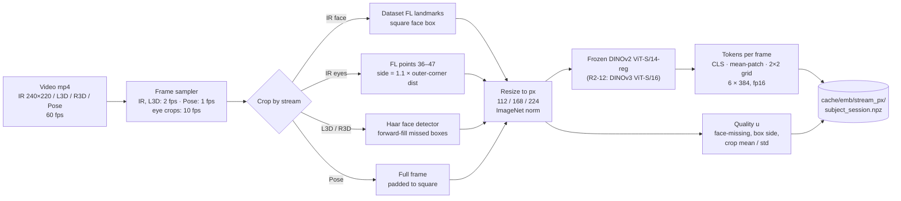

### 1.2 Window bank, normalisation and training loop

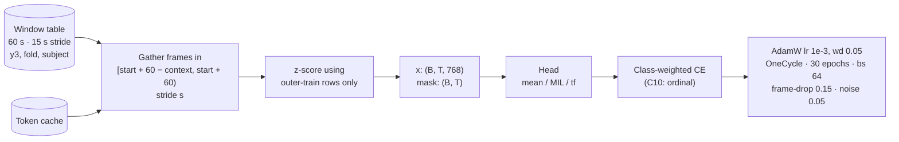

Training augmentation: 15% random frame drop and Gaussian feature noise (σ 0.05). Each config
runs with 3 seeds. The inner 4-fold OOF gives the selection score.

---

## 2. Reference baselines

### R1 — Clock only

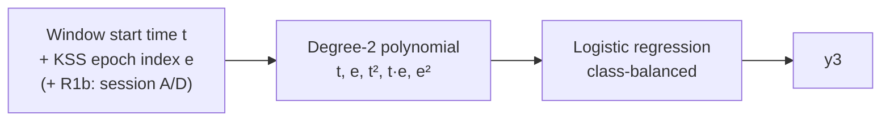

### R4 / R4s — Honest M5 (YOLOv8n-cls)

Retrained per outer fold at 0.5 fps for 10 epochs, with `best.pt` chosen on inner-validation
subjects. R4s is the 3-seed ensemble, followed by window averaging and a causal EMA (β chosen on
the inner split).

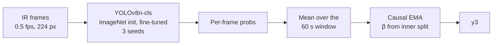

### R6 — Tabular window statistics

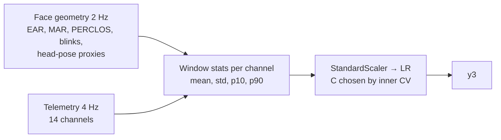

---

## 3. Single-stream heads (C1–C5)

Every head takes `(x: B×T×768, mask: B×T)`. T = 120 for IR/L3D at 2 fps, 60 for pose at 1 fps,
600 for eye crops at 10 fps, and 120 for 240 s context at stride 4.

### Mean-pool head — V\* (C1, IR 112)

The linear-probe control, and the winner. 3,843 trainable parameters (LayerNorm 1,536 + Linear 2,307).

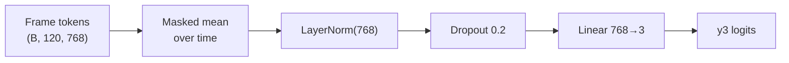

### Gated attention-MIL head (C1, C2, C3)

Uses Ilse et al. 2018 gated attention.

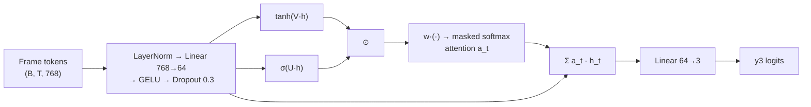

### Temporal transformer head (C5)

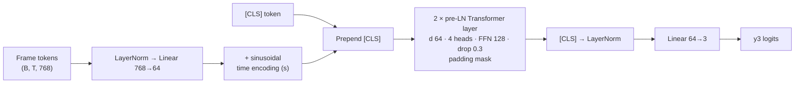

### Long causal context (C5, `--context 240 --ctx-stride 4`)

The context only changes which frames feed any of the heads above.

### Landmark / AU / geometry stream (C4) and telemetry expert (C7)

Both use `series_bank` with the same three heads. Landmark/AU/geometry runs at 2 Hz (120 steps)
and telemetry at 4 Hz (240 steps).

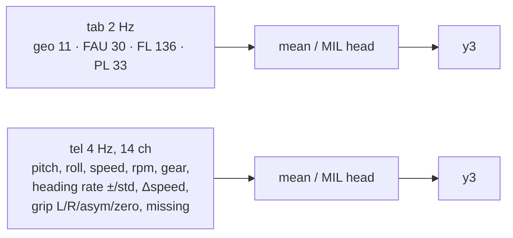

### Two-view test-time averaging (C2)

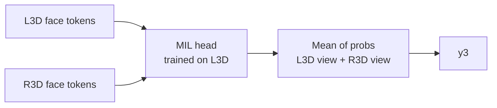

---

## 4. Fusion, gate and M8

### C6 / C8 — Late fusion

Uses stream log-probabilities from separately trained heads.

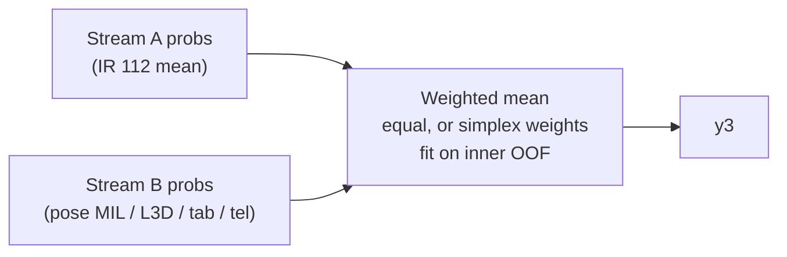

### C9 — VIGIL residual-gate family (`vision`, `gate`, `late`, `clock`)

The correction branch's last layer is zero-initialised, so training starts as vision only.

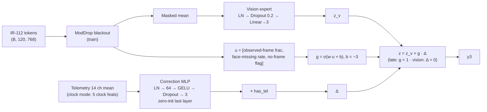

### C9b/c — MoE family (`moe`, `moe_clock`)

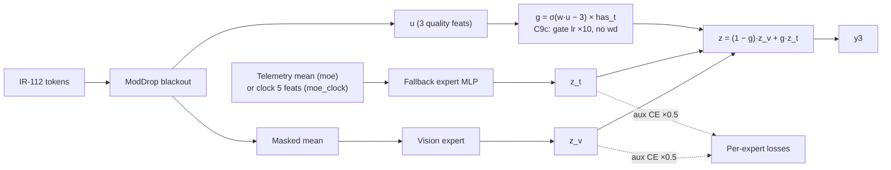

### M8 (frozen) — C9d `moe_telclock`

`m8/vigil.py`, mode `moe_telclock`. Results file:
`results/m8/C9d_ir112_moe_telclock.json`.

**Frozen config:**
- Optimisation: 30 epochs, bs 64, AdamW lr 1e-3, wd 0.05, OneCycle.
- Gate: bias −3, gate lr ×10 with no weight decay.
- ModDrop: p_black 0.5 (15–60 s contiguous; 25% of hits are a full 60 s), p_tel_drop 0.1.
- Augmentation and loss: frame-drop 0.15, noise 0.05, aux_w 0.5.
- Seeds 0, 1, 2.

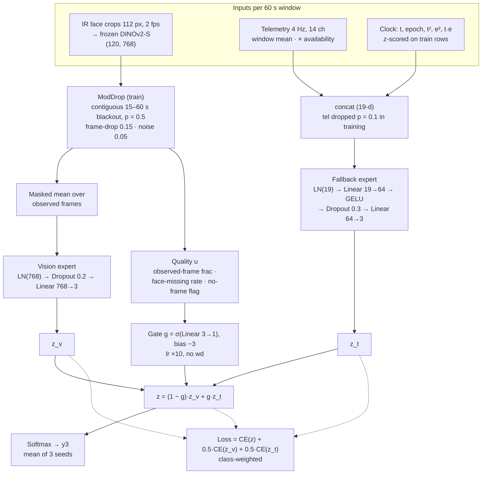

| Test condition | Fold-mean | Pooled | Gate mean | vs vision-only (same ModDrop) |
|---|---|---|---|---|
| Clean | 0.416 | 0.428 | 0.13 | Δ −0.002, p = 0.80 (do-no-harm) |
| 30 s blackout | 0.417 | 0.426 | 0.16 | — |
| 45 s blackout | 0.413 | 0.423 | 0.19 | — |
| 60 s blackout (no frames) | 0.326 | 0.349 | **0.93** | **Δ +0.163, p = 0.076** |

---

## 5. Late ablations (C10, C12) and round 2

### C10 — Ordinal head

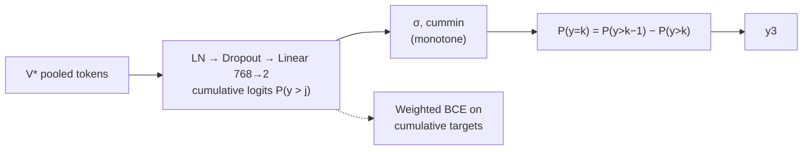

### C12 / R2-7 / R2-8 — Reference calibration

`video_bank(ref_s=240, ref_session=…, ref_concat=…)`:
- **C12:** the reference is the same session's first 240 s. This is negative.
- **R2-7:** the reference is the subject's Alert session, applied to both of the subject's
  sessions (0.500 / 0.521).
- **R2-8:** concatenate [abs, abs − ref] instead (0.383).

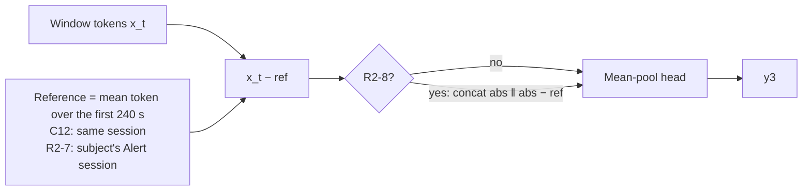

R2-7 caveat: the gain is concentrated in the A session after its first 4 min (+0.092). The D
session gets worse (−0.050). The session audit is unchanged (0.62). UL-DD has only two sessions
per subject, so a clean third-day calibration test is impossible. Report it as P4/H4
(optimistic).

### R2-1 / R2-4 — 60 fps event features (`m8/events.py`)

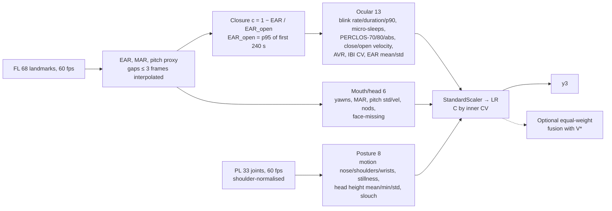

| Group | 5-fold | Pooled | LOSO pooled | Session audit (chance 0.5) |
|---|---|---|---|---|
| Ocular (13) | 0.372 | 0.375 | 0.378 | 0.60 |
| Mouth/head (6) | 0.315 | 0.314 | 0.328 | 0.61 |
| Posture (8) | 0.386 | 0.449 | 0.433 | **0.455** |
| All 27 | **0.440** | **0.480** | 0.430 | 0.61 |
| All + V\* (equal) | 0.445 | 0.461 | — | Δ vs V\* +0.016, p = 0.64 |

### R2-2 — IR eye-region crops at 10 fps

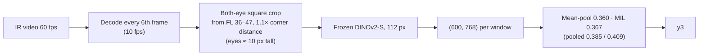

### R2-12 — DINOv3-S/16 encoder swap

The same pipeline as §1.1, with the encoder `vit_small_patch16_dinov3.lvd1689m`. At 112 px that
gives a 7×7 patch grid, pooled to 2×2 on the CPU. Result: 0.329 / 0.325, negative.

### V1 — LOSO protocol

Not a new architecture:
- 16 subject folds with no inner CV (`--protocol loso`); pooled F1 is the headline.
- It tests the D5 learning curve: 12 training subjects → 0.426, 15 → 0.506 (linear probe).
- Results (pooled F1; LOSO fold-means are not meaningful with single-subject folds):

| Model | 5-fold pooled | LOSO pooled [95% CI] | Δ (5-fold → LOSO) |
|---|---|---|---|
| V\* IR-112 mean | 0.446 | **0.471** [0.39, 0.55] | +0.025 (p = 0.30) |
| Alert-calibrated V\* (P4) | 0.521 | **0.518** [0.42, 0.61] | −0.003 |
| Pose MIL | 0.499 | 0.409 [0.28, 0.54] | **−0.090** |
| Events LR (27) | 0.480 | 0.430 | −0.050 |
| Linear probe (D5) | — | 0.506 | — |

- Reading: V\* gains a little from 15 training subjects, but less than the linear-probe curve
  suggested. Pose and events *lose* under LOSO, so their 5-fold pooled advantage over V\* was
  fold-composition luck (pose also fails the session audit).
- **IR-112 is the most stable stream across protocols**, which supports V\* as the M8 core.
- Calibration keeps its level under LOSO.
- Per-subject LOSO F1 ranges from 0.02 to 0.57 for V\*, so subject variance dominates.

---

## 6. Diagnostics used to judge these models

| Check | Result | Source |
|---|---|---|
| D1 KSS variance split | 67% between A/D sessions, 16% between subjects, 18% within a session | `diag_bottlenecks.json` |
| D2 V\* Spearman with KSS | 0.12 within session, 0.10 session-level | 〃 |
| D3 Oracle subject offset | +0.08 F1 headroom | 〃 |
| D5 Learning curve | 4 → 0.365, 12 → 0.426, LOSO(15) → 0.506 | 〃 |
| D6 Telemetry → time R² | 0.04 | 〃 |
| Session audit (KSS 5–6) | IR ≈ chance; pose 0.67, L3D 0.73; posture events 0.455 | `probe_session_identity.json`, `R2_events.json` |
| Beats the clock | V\* +0.079 (p 0.31); M8 +0.062; events +0.114 (p 0.066) | `compare_*.json` |
| Inner-OOF vs test correlation | r = 0.22 over 14 runs | story 2026-11-06 |
