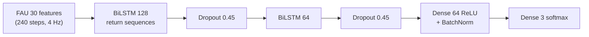
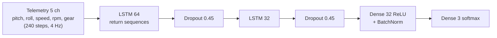
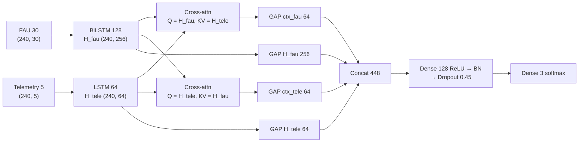
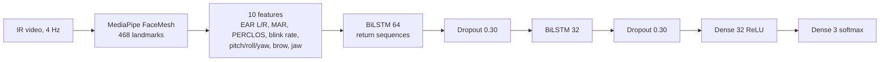
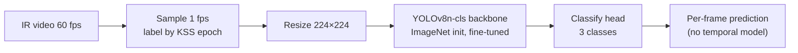
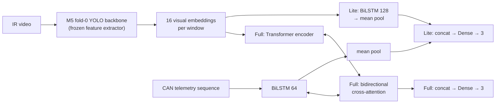
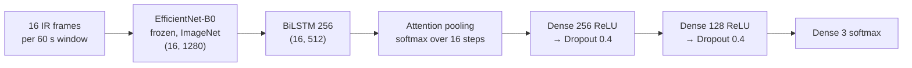

# Models Summary — M1 through M7 (reproduction phase)

Detailed, per-model reference for every model built or reproduced in this project. All 3-class
(Alert/LowVigilant/Drowsy) classification on UL-DD KSS labels, subject-independent 5-fold CV
(`FOLDS`: fold0=A,B,C,D · fold1=E,F,G,H · fold2=I,J,K · fold3=L,M,N,O · fold4=P,Q,R,S), unless noted
otherwise. Metrics: accuracy and macro-F1 (macro-F1 is the project's primary metric throughout,
chosen because class balance varies by fold — see `docs/report_summary.md` §4).

For narrative/chronology see `docs/story_so_far.md`; for code provenance (what's Kavipriya's
unmodified code vs. new work vs. locally-patched bugs) see `docs/repo_understanding.md`.

**Final-phase models** (R1/R4s baselines, C1–C12, VIGIL/M8, round 2) are documented separately in
[`m8_models.md`](m8_models.md), with results tables and an architecture diagram per variant. This
file covers the reproduced/rebuilt M1–M7 only.

---

## M1 — Facial BiLSTM (FAU-only baseline)

**Modality:** Facial Action Units only (30 features, derived from Dlib 68-point landmarks on IR video).
**Code:** Kavipriya's unmodified `src/models/architecture.py:build_m1_facial_bilstm` +
`src/models/train.py:cross_validate`. Driver script: `scripts/m1/train_m1.py`.

**Architecture:**
```
Input (batch, 240, 30)                        # 60s window @ 4Hz × 30 FAU features
 → Bidirectional(LSTM(128, return_sequences=True))  # + L2 reg
 → Dropout(0.45)
 → Bidirectional(LSTM(64))
 → Dropout(0.45)
 → Dense(64, relu, L2 reg) → BatchNormalization()
 → Dense(3, softmax)
```


335,875 parameters (thesis docstring claims ~420K — a minor doc/reality mismatch, not a bug).

**Training:** Adam, lr 5e-4, label-smoothed (0.1) sparse categorical cross-entropy, class-balanced
weights recomputed per fold, batch size 32, up to 200 epochs with `EarlyStopping(monitor=
'val_accuracy', patience=25)` + `ReduceLROnPlateau`, 15% validation split from each fold's training
subjects. **No random seed set anywhere** in the pipeline — weight init/dropout are unseeded, so
exact reproduction run-to-run isn't possible even with identical code+data (see
`docs/repo_understanding.md` §9 for the full implication of this).

**Dataset:** All FAU-available sessions used regardless of telemetry availability (includes
subject A, which has no telemetry). 60Hz FAU CSV downsampled to 4Hz, 60s/15s sliding windows.

**Results:**

| Fold | Accuracy | Macro-F1 |
|---|---|---|
| 0 (A,B,C,D) | 0.341 | 0.337 |
| 1 (E,F,G,H) | 0.488 | 0.481 |
| 2 (I,J,K) | 0.485 | 0.353 |
| 3 (L,M,N,O) | 0.189 | 0.170 |
| 4 (P,Q,R,S) | 0.446 | 0.446 |
| **Mean ± std** | **0.390 ± 0.114** | **0.357 ± 0.108** |

**Thesis comparison:** 0.391 ± 0.116 acc / 0.348 macro-F1 — **near-exact match**, the strongest
reproduction-fidelity evidence in the whole project (identical architecture/data/training loop
landing this close despite the unseeded-training caveat above).

**Notable:** Fold 3 (L,M,N,O) is the weakest fold by a wide margin here and remains the weakest
fold for M2 and M3 as well — a real, recurring finding, not noise (see `docs/repo_understanding.md`
§9's discussion of why this deserves a dedicated look).

---

## M2 — Telemetry LSTM (CAN/vehicle-signal-only baseline)

**Modality:** Vehicle telemetry only — pitch, roll, speed, rpm, gear (5 features, 60Hz simulator
output downsampled to 4Hz).
**Code:** Kavipriya's unmodified `build_m2_telemetry_lstm` + `cross_validate`. Driver script:
`scripts/m2/train_m2.py`.

**Architecture:**
```
Input (batch, 240, 5)
 → LSTM(64, return_sequences=True)   # unidirectional — telemetry treated as causal
 → Dropout(0.45)
 → LSTM(32)
 → Dropout(0.45)
 → Dense(32, relu, L2 reg) → BatchNormalization()
 → Dense(3, softmax)
```


~45K parameters. Deliberately **unidirectional** (unlike M1's BiLSTM) — the architecture's own
docstring reasoning: "telemetry is causal: past steering causes future vehicle state."

**Training:** Same protocol as M1 (Adam 5e-4, label smoothing, class weights, early stopping on
val_accuracy).

**Dataset:** Only sessions with both FAU and telemetry present (`mm_*` arrays) — excludes subject
A (no telemetry) and subjects B/I/M (no video, though telemetry-only wouldn't strictly need
video — this exclusion is inherited from how the aligned fold data was built).

**Results:**

| Fold | Accuracy | Macro-F1 |
|---|---|---|
| 0 | 0.377 | 0.249 |
| 1 | 0.290 | 0.184 |
| 2 | 0.421 | 0.386 |
| 3 | 0.309 | 0.287 |
| 4 | 0.222 | 0.191 |
| **Mean ± std** | **0.324 ± 0.069** | **0.259 ± 0.074** |

**Thesis comparison:** 0.387 ± 0.040 acc / 0.339 macro-F1 — reproduced result is meaningfully
lower, driven mostly by weak folds 1 and 4.

**Notable:** **Weakest unimodal model of the whole project.** This is the empirical basis for
treating telemetry as a "weak auxiliary signal" throughout — every fusion model that includes
telemetry (M3, M6 Lite, M6 Full) underperforms the best vision-only model, and M2's low ceiling is
the leading explanation floated in `model_research/README.md` §3.1 for why.

---

## M3 — Cross-Modal Attention Fusion (FAU + Telemetry)

**Modality:** FAU (30 features) + Telemetry (5 features), fused. Described in the thesis as its
main methodological contribution over the dataset paper's simple SVM/RF early fusion.
**Code:** Kavipriya's unmodified `M3FusionModel` (subclassed `tf.keras.Model`) + `cross_validate`.
Driver script: `scripts/m3/train_m3.py`.

**Architecture:**
```
FAU  branch: BiLSTM(128, return_sequences=True) → H_fau  (B, 240, 256)
Tele branch: LSTM(64,  return_sequences=True)   → H_tele (B, 240,  64)

Cross-attention (bidirectional):
  ctx_fau  = CrossModalAttentionBlock(query=H_fau,  kv=H_tele)   (B, 240, 64)
  ctx_tele = CrossModalAttentionBlock(query=H_tele, kv=H_fau)    (B, 240, 64)
  (scaled dot-product attention, d_model=64, learned Q/K/V/output projections)

Pool (GlobalAveragePooling1D each): ctx_fau(64) | ctx_tele(64) | H_fau(256) | H_tele(64)
  → concat (448-d) → Dense(128, relu) → BatchNorm → Dropout(0.45) → Dense(3, softmax)
```


~750K parameters. Same training protocol as M1/M2 (label-smoothed CE, class weights, early
stopping on val_accuracy, unseeded).

**Dataset:** Same `mm_*` aligned FAU+telemetry sessions as M2.

**Results:**

| Fold | Accuracy | Macro-F1 |
|---|---|---|
| 0 | 0.465 | 0.457 |
| 1 | 0.495 | 0.479 |
| 2 | 0.363 | 0.276 |
| 3 | 0.181 | 0.157 |
| 4 | 0.256 | 0.243 |
| **Mean ± std** | **0.352 ± 0.120** | **0.322 ± 0.125** |

**Thesis comparison:** 0.399 ± 0.098 acc / 0.378 macro-F1 — reproduced result is somewhat lower,
again driven mostly by fold 3's collapse (0.157 F1, consistent with M1's fold 3 problem).

**Notable:** Despite being the more sophisticated fusion mechanism, M3 does not beat M1
(facial-only) on macro-F1 in this reproduction (0.322 vs. 0.357) — an early instance of the
"fusion underperforms the best single modality" pattern that recurs throughout M6 as well.

---

## M4 — Real-Time BiLSTM (10 geometric features)

**Modality:** 10 real-time drowsiness features computed from MediaPipe FaceMesh 468 landmarks:
EAR (left/right), MAR, PERCLOS, blink rate, head pitch/roll/yaw, brow raise, jaw drop.
**Code:** Kavipriya's unmodified `build_m4_realtime_bilstm` architecture and `cross_validate`
training loop, but **the entire data pipeline is new** — she designed M4 only for a live-webcam
demo and never trained it on UL-DD at all (confirmed: no `m4_*` preprocessing script exists
anywhere in her repo history). This project built the offline extraction from scratch: sample IR
video at 4Hz (matching every other model's window rate, rather than her live pipeline's ad-hoc
frame rate), run MediaPipe FaceLandmarker per frame, compute the 10 features with the same
formulas/thresholds as her live `src/face_detection.py` (EAR/MAR geometry, PERCLOS 2s rolling
window, blink-rate 60s rolling window) but keyed to video timestamp instead of wall-clock
`time.time()`. Extraction script: `scripts/common/extract_m4_m5_features.py` (shared decode pass
with M5, see below). Driver script: `scripts/m4/train_m4.py`.

**Architecture:**
```
Input (batch, 240, 10)
 → Bidirectional(LSTM(64, return_sequences=True))
 → Dropout(0.30)
 → Bidirectional(LSTM(32))
 → Dropout(0.30)
 → Dense(32, relu)
 → Dense(3, softmax)
```


~82K parameters — designed to be lightweight/edge-deployable for the live-demo use case.

**Dataset:** Same `NO_VIDEO = {B, I, M}` exclusion as every video-dependent model. **Environment
note:** MediaPipe's modern `FaceLandmarker` Tasks API hard-crashes on this Mac (Apple Silicon) with
a Metal-GPU error regardless of CPU-delegate settings — worked around by using the older
`mp.solutions.face_mesh.FaceMesh` API instead, pinned to `mediapipe==0.10.21` in its own dedicated
conda env (`mp-extract`), kept separate from the `ddd-repo` training env because newer mediapipe
conflicts with TensorFlow's dependency pins.

**Results:**

| Fold | Accuracy | Macro-F1 |
|---|---|---|
| 0 | 0.280 | 0.220 |
| 1 | 0.385 | 0.267 |
| 2 | 0.441 | 0.382 |
| 3 | 0.315 | 0.224 |
| 4 | 0.346 | 0.280 |
| **Mean ± std** | **0.353 ± 0.056** | **0.275 ± 0.058** |

**Thesis comparison:** none — **this is the first time M4 has ever been trained on UL-DD.**
Reasonable outcome given it uses only 10 coarse geometric features vs. M1's 30 FAU features;
landing close to M1's ballpark (0.275 vs. 0.357 F1) is a sensible result, not an anomaly.

---

## M5 — YOLOv8n-cls Image Classification (best model)

**Modality:** Raw IR video frames, classified independently per frame (no temporal modeling).
**Code:** Ported from Kavipriya's notebook `09-uldd-m5-yolo-cls.ipynb` into a headless script
(`scripts/m5/train_m5.py`) for background/unattended execution, with hardcoded Windows paths fixed
via CLI-equivalent constants and **one real bug fix**: her code had no MPS device check at all
(defaulted straight to CPU), confirmed burning CPU cycles at ~10x slower speed before being caught
and fixed (`device='mps', workers=8` added to `model.train()`).

**Architecture:** YOLOv8n-cls (nano), ImageNet-pretrained, fine-tuned. ~1.44M parameters, ~3.4 GFLOPs.



**Pipeline:** IR video (240×220 @ 60fps) → sample at 1 fps (~2,400 frames/40-min session) → label
each frame by its KSS epoch (240s blocks) → resize to 224×224 → fine-tune 20 epochs, batch 32,
imgsz 224, lr0=1e-3, lrf=0.01, dropout=0.3, patience=15, optimizer auto-selected. **Class-index
gotcha:** YOLO sorts class folder names alphabetically internally (Alert=0, Drowsy=1,
LowVigilant=2), which does not match the project's `[Alert, LowVigilant, Drowsy]` ordering — the
training script explicitly remaps `yolo_names → CLASS_NAMES` before computing metrics.

**Dataset:** `NO_VIDEO = {B, I, M}` excluded from both train and test in every fold. Frame
extraction and per-fold dataset assembly (train/val class-folder structure via hardlinks) done via
`scripts/m5/train_m5.py`'s adaptation of the notebook's cells 3–13.

**Results:**

| Fold | Accuracy | Macro-F1 |
|---|---|---|
| 0 (A,C,D) | 0.597 | 0.488 |
| 1 (E,F,G,H) | 0.482 | 0.472 |
| 2 (I,J,K) | 0.461 | 0.319 |
| 3 (L,N,O) | 0.670 | 0.524 |
| 4 (P,Q,R,S) | 0.493 | 0.431 |
| **Mean ± std** | **0.541 ± 0.080** | **0.447 ± 0.071** |

**Thesis comparison:** 0.545 ± 0.100 acc / 0.444 macro-F1 — **near-exact match**, and macro-F1
landed marginally *higher* than the thesis's own number.

**Notable:** **The best model in the entire project, by a clear margin, and remains so after every
subsequent fusion/temporal attempt (M6, M7).** Interestingly, fold 3 here excludes subjects M
(no video) unlike M1/M2/M3's fold 3, so M5's fold 3 is *not* comparable to the "fold 3 is always
weakest" pattern seen elsewhere — here fold 3 is actually M5's *best* fold. Per-class confusion
(from the thesis's own aggregate matrix, not re-derived here): Alert vs. LowVigilant is the
dominant error (~62% of Alert samples predicted LowVigilant), while Alert vs. Drowsy is rare
(~5%) — the single most important per-class finding motivating `model_research/README.md`'s
Direction 2 (ordinal-aware loss).

---

## M6 — Visual + CAN Fusion (Lite and Full variants)

**Modality:** 60fps-aligned visual embeddings (from a fine-tuned M5 backbone) + telemetry.
**Code:** Kavipriya's unmodified `src/models/m6_fusion.py` (PyTorch) architectures and
`src/models/m6_train.py` training loop — **but this session found and locally patched three real
bugs that blocked her own already-written alignment fix from ever running at all**:
1. Validation wrongly expected video embeddings for subjects B/I/M (never had video) and wrongly
   excluded subject A (does have video) — a `NO_TELEMETRY` check was used where `NO_VIDEO` was
   needed, in two functions. Added a proper `NO_VIDEO` constant and fixed both.
2. A hardcoded 2% tolerance gate blocked her own `_allocate_session_counts` proportional-
   reallocation logic from running whenever the video-vs-FAU-CSV window-count gap exceeded it —
   real observed gaps ranged 12% (fold 0) to 33% (fold 2). Removed the arbitrary cutoff entirely.
3. No MPS device check at all (same class of bug as M5) — added it.

All three patches are local, uncommitted changes to her nested repo — not pushed anywhere, not a
redesign, purely unblocking her own intended pipeline. Full detail in `docs/story_so_far.md`'s
2026-09-08 entry.

**Architectures:**
- **M6 Lite** (`M6_Lite`/`M6_Lite_v2`): BiLSTM(128, bidir) over 16 sampled visual embeddings per
  window + BiLSTM(64, bidir) over the CAN telemetry sequence, mean-pooled each, concatenated,
  Dense classifier. ~481K parameters.
- **M6 Full** (`M6_Full`/`M6_Full_v2`): Transformer encoder over the visual embedding sequence +
  BiLSTM(64, bidir) over CAN, bidirectional cross-attention between the two, concatenated, Dense
  classifier. ~749K parameters.



**Training:** Adam/AdamW (lr 3e-4 default), 50 epochs, no early stopping used in the final runs
(both variants trained the full 50 epochs). No wandb integration in her code at all — this
project's results were backfilled into wandb after training completed
(`scripts/helpers/wandb_backfill_m6_m7.py`).

**Pipeline:** 60fps embeddings extracted via `python -m src.models.m6_extractor_from_video`
(her script, unmodified, just CLI-parameterized) using the project's regenerated `M5_fold0.pt`
backbone as the feature extractor for *all* subjects/folds (matching her original design choice —
not fold-specific backbones, a design choice this project didn't change). ~4-5 hours for the full
60fps extraction pass, timed and confirmed feasible before committing to the run.

**Results:**

| Fold | M6 Lite Acc | M6 Lite F1 | M6 Full Acc | M6 Full F1 |
|---|---|---|---|---|
| 0 | 0.388 | 0.319 | 0.361 | 0.304 |
| 1 | 0.343 | 0.329 | 0.396 | 0.349 |
| 2 | 0.318 | 0.268 | 0.253 | 0.232 |
| 3 | 0.292 | 0.287 | 0.252 | 0.251 |
| 4 | 0.320 | 0.314 | 0.327 | 0.321 |
| **Mean ± std** | **0.332 ± 0.032** | **0.303 ± 0.022** | **0.318 ± 0.058** | **0.292 ± 0.044** |

**Thesis comparison (original, broken 1fps-alignment version):** Lite 0.405 acc / 0.360 F1; Full
0.420 acc / 0.377 F1.

**Notable — the single most important negative result in the project:** **both variants got
*worse* after the alignment fix, not better.** This was not hidden or re-run away — it's
documented as a genuine finding. Leading hypothesis: the proportional window-reallocation needed
to bridge the 12–33%-per-fold video/FAU-CSV duration mismatch (bug #2 above) introduces its own
label-to-embedding alignment noise, trading a coarse-but-consistent 1fps sampling error for a
finer-grained but less-certain window-correspondence error. This result is the direct motivation
for `model_research/README.md`'s Direction 1 (gated/residual fusion) — the hypothesis there is
that the problem is the fusion *mechanism* (concatenation/attention treating a noisy telemetry
signal as an equal partner) rather than embedding alignment precision specifically, since neither
the original nor the fixed alignment beat unimodal M5.

---

## M7 — Temporal Infrared Video Model (built from scratch)

**Modality:** 16 sampled raw IR frames per 60s window, EfficientNet-B0 features + temporal head.
**Code:** **Entirely new — no `src/models/m7_*.py` exists anywhere in Kavipriya's git history.**
The thesis describes this architecture in detail (per `docs/report_summary.md` §3.5.7) but the
code, training run, and results were never actually completed or committed. This project built it
from scratch this session: `scripts/m7/extract_m7.py` (feature extraction) and
`scripts/m7/train_m7.py` (model + training loop), using her *existing* preprocessed window
metadata (`datasets/processed/uldd_m7/fold_{0..4}.npz` — clean subject/session/window-range
metadata that *did* already exist, just with no visual features attached) as the source of truth
for which windows exist and their labels.

**Architecture:**
```
16 IR frames/window → EfficientNet-B0 (frozen, ImageNet-pretrained) → (16, 1280) features
 → BiLSTM(256, bidirectional) → (16, 512)
 → Attention pooling (learned per-timestep weights, softmax over 16 steps) → (512,)
 → Dense(256, relu) → Dropout(0.4) → Dense(128, relu) → Dropout(0.4) → Dense(3, softmax)
```


PyTorch. Training: Adam (lr 1e-3, weight decay 1e-4), label-smoothed (0.1) class-weighted
cross-entropy, up to 100 epochs with early stopping (patience 15, monitor val_accuracy),
`ReduceLROnPlateau`. Live wandb logging per fold from the start (unlike M6).

**Extraction:** For each of the 5,367 global windows (shared across folds, just re-partitioned),
sample 16 frames uniformly across the window's 60fps frame range (`start_4hz*15` to `end_4hz*15`),
skip subjects in `NO_VIDEO`, cache per-window features once and reuse across all 5 folds'
train/test assignments (avoids redundant computation). ~18 minutes total on MPS for all 4,429
video-available windows.

**Results:**

| Fold | Accuracy | Macro-F1 | Per-class F1 (Alert / LowVigilant / Drowsy) |
|---|---|---|---|
| 0 | 0.474 | 0.281 | 0.000 / 0.817 / 0.026 |
| 1 | 0.444 | 0.358 | 0.000 / 0.548 / 0.525 |
| 2 | 0.534 | 0.425 | 0.000 / 0.801 / 0.473 |
| 3 | 0.376 | 0.287 | 0.189 / 0.495 / 0.177 |
| 4 | 0.433 | 0.423 | 0.463 / 0.331 / 0.474 |
| **Mean ± std** | **0.452 ± 0.052** | **0.355 ± 0.063** | — |

**Thesis comparison:** the thesis states 0.434 acc / 0.314 macro-F1 for "M7," but
`docs/repo_understanding.md` §7 flags this specific number as **unverifiable** — it comes from a
document (`M7_COMPLETION_STATUS.md`) describing a *different* M7 ("hybrid ensemble of M1/M2/M5
predictions") than the EfficientNet-B0+BiLSTM+attention architecture actually documented as the
real design elsewhere in her repo. This project's number (0.452/0.355) is close to, and slightly
above, that informally-stated figure — a reasonable cross-check on both, without over-claiming
either is "correct."

**Notable:** Complete failure on the Alert class in folds 0–2 (F1=0.000) — every Alert window in
those folds' test sets was misclassified. Folds 3–4 (which include subjects with more Alert
representation) show the model *can* learn Alert when there's enough signal, suggesting a
class-imbalance-per-fold problem compounding the already-known Alert/LowVigilant confusability
issue, not a fundamental inability to represent Alert.

---

## Summary comparison table

| Model | Modality | Accuracy | Macro-F1 | vs. Thesis | Status |
|---|---|---|---|---|---|
| M1 | FAU | 0.390 ± 0.114 | 0.357 ± 0.108 | ≈ exact match | reproduced |
| M2 | Telemetry | 0.324 ± 0.069 | 0.259 ± 0.074 | below | reproduced |
| M3 | FAU + Telemetry (attention) | 0.352 ± 0.120 | 0.322 ± 0.125 | below | reproduced |
| M4 | 10 real-time geometric features | 0.353 ± 0.056 | 0.275 ± 0.058 | no target | first-ever result |
| **M5** | **Raw IR frames (YOLOv8n-cls)** | **0.541 ± 0.080** | **0.447 ± 0.071** | ≈ exact match | **reproduced — best model** |
| M6 Lite | Visual embeddings + Telemetry | 0.332 ± 0.032 | 0.303 ± 0.022 | below (fix made it worse) | fixed + retrained |
| M6 Full | Visual embeddings + Telemetry (cross-attn) | 0.318 ± 0.058 | 0.292 ± 0.044 | below (fix made it worse) | fixed + retrained |
| M7 | 16-frame EfficientNet-B0 + BiLSTM + attention | 0.452 ± 0.052 | 0.355 ± 0.063 | ≈ matches informal figure | built from scratch |

**M5 remains the strongest model by a clear margin.** No fusion or temporal-modeling attempt in
this project or the thesis has beaten frame-level visual classification — see
`model_research/README.md` for the research plan aimed at changing that.

> **Update (2026-11-06):** the honest retrain of M5 in the final phase (R4s: inner-validation
> `best.pt`, not test-selected) scores **0.333 fold-mean / 0.367 pooled**, about the level of a
> clock-only baseline (R1, 0.355). The 0.447 above used test-fold checkpoint selection. The
> final-phase best is V\* (frozen DINOv2 IR-112 + mean-pool, 0.440), and the frozen final model is
> M8. See [`m8_models.md`](m8_models.md).
