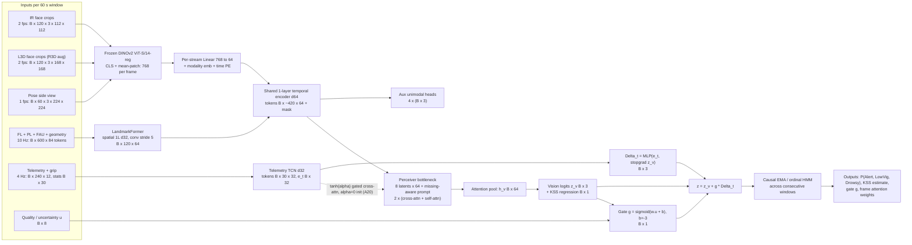

# Ablation Plan: 18 Days on an Apple M4 (16 GB)

*Written 2026-11-05. This is the execution plan for the modelling phase and pairs with [`literature_survey.md`](literature_survey.md), which holds the evidence and citations behind each choice here. All compute estimates are anchored to the local benchmark of 2026-11-05. That benchmark ran in Low Power Mode on battery, so its throughput figures are lower bounds; every time estimate below already includes about a 2× safety margin.*

---

## 0. Summary

- **Main bet.** Frozen generic ViT encoders (DINOv2-S/14, optionally DINOv3-S/16 and MARLIN-S), cached once, then tiny temporal and fusion heads (about 50k–350k trainable parameters) trained in minutes per run. **About 290 independent labels cannot support fine-tuning large backbones.** The literature (LP-FT, Lakhani's Video-Swin result of 44%) and M5's own training curves both say so.
- **Flagship: VIGIL-Former.** The name is short for Vision-primary, Gated-Input, Latent-bottleneck transformer. It works as follows:
  - Frozen DINOv2 tokens come from three camera views (IR face, L3D face, side Pose) plus a landmark/skeleton stream.
  - The streams are fused through an 8-latent Perceiver/MBT bottleneck.
  - Telemetry and grip enter only through a zero-initialised gated residual logit correction.
  - The gate is driven by vision uncertainty and quality.
  - Causal smoothing runs across consecutive windows.
- **Size of the plan.** 25 ablations (A1–A25) in five groups, plus 6 reference runs (R0–R5). One-off feature extraction is about 2–4 h of GPU time and under 6 GB of disk.
- **Calibrated targets.** Under the primary protocol (3-class, subject-independent, no calibration), **0.50–0.55 macro-F1 would be a strong result**, and **0.70–0.80 is not credible**: nothing in the literature reaches it without leaky splits, acted or binary data, objective labels, or per-driver calibration. 0.65–0.75 is plausible only for the binary protocol, and about 0.60 only for the calibrated protocol.

### 0.1 A finding that changes the baseline (verified 2026-11-05)

**M5's reported numbers rely on test-set checkpoint selection.** `scripts/m5/train_m5.py` links each fold's *test* subjects into the Ultralytics `val/` split. For example, `fold_0/val/` contains C_A and D_A frames. Ultralytics then picks `best.pt` by val top-1 accuracy. The per-fold accuracies reported in `docs/models_summary.md` (0.597 / 0.482 / 0.461 / 0.670 / 0.493) are exactly the **best test-set epoch** in each `results.csv`.

| Fold | Best epoch on test | Best-epoch acc | Last-epoch acc |
|---|---|---|---|
| 0 | 1 | 0.597 | 0.383 (early-stopped at 16) |
| 1 | 6 | 0.482 | 0.395 |
| 2 | 5 | 0.461 | 0.381 |
| 3 | 2 | 0.669 | 0.616 (early-stopped at 17) |
| 4 | 15 | 0.494 | 0.432 |

Mean last-epoch accuracy is **0.441, against the reported 0.541**. Macro-F1 at the last epoch has not been computed yet; that is a Day-1 job.

Implications:

1. **0.447 is an optimistic upper bound on M5**, not an honest held-out score.
2. **New models must be compared against an honestly re-selected M5** (R4 below). This is the fair comparator. The 0.447 headline is still reported for continuity with Kavipriya's thesis.
3. **M5 overfits within 1–6 epochs on most folds.** That is direct evidence for the frozen-encoder policy.
4. **The report must state this plainly.** It is a methodological contribution, not an embarrassment, and it is the same class of issue the literature flags across drowsiness work (see `literature_survey.md` §3.1).

---

## 1. Evaluation protocol

### 1.1 Primary benchmark: P0 (kept, comparable with M1–M7)

| Item | Decision |
|---|---|
| Split | Subject-independent 5-fold, unchanged: fold0 ABCD, fold1 EFGH, fold2 IJK, fold3 LMNO, fold4 PQRS. Vision models use the 16 video subjects, so B, I and M are absent from test. |
| Unit | 60 s window, 15 s stride, label inherited from the KSS epoch, using the same window rule as the existing `uldd_m7` index (`mm_start_4hz`/`mm_end_4hz`; 60 fps frame = 4 Hz index × 15). One canonical window table (§2.1) is used by **every** model, so all models are scored on identical windows. |
| Classes | Alert (KSS ≤ 3) / LowVigilant (4–6, including 4.5) / Drowsy (> 6, including 6.5). |
| Primary metric | Macro-F1, mean ± std over the 5 outer folds. Each fold's value is the mean over 3 seeds. |
| Also reported | Pooled macro-F1 over all test windows, balanced accuracy, per-class F1, quadratic-weighted κ, and pooled confusion matrix. |
| Model selection | **Only inside each outer training set.** Every outer fold has a fixed inner-validation pair of subjects that includes Alert epochs, listed in `configs/inner_val.yaml` before any run. Early stopping, hyperparameters, thresholds, temperatures, gate penalties and smoothing β are all chosen on inner validation. **Outer test folds are never used for selection.** |
| OOF logits for fusion | Inner 4-fold subject-wise split of each outer training set. Needed for gates, stacking and temperature scaling (§3, G4). |

### 1.2 Additional protocols

**Comparability rule.** Results under a protocol other than P0 are **not comparable** to the 3-class numbers for M1–M7. Every such table must include M5 re-evaluated under that same protocol, on the same windows, side by side.

| ID | Protocol | Why | Comparable with P0? | M5 reference |
|---|---|---|---|---|
| **P1** | **Epoch-level.** Average window log-probabilities over each 4-min KSS epoch, giving 290 epochs. | The label resolution is 4 min. Massoz shows accuracy rises with window length. This is the honest unit of independent labels. | Same classes and folds, different unit. Report next to P0, never instead of it. | R3/R4 aggregated to epochs |
| **P2** | **Ordinal training.** Regress KSS 1–9 or use a CORN head, then threshold into 3 classes. Thresholds start at 3.5 / 6.25 and are tuned on inner validation. | Uses all 12 KSS levels and respects ordering. Adds MAE, Spearman ρ and QWK. | **Yes.** The output is still 3-class on the same windows; only the training objective changes. | R4 |
| **P3** | **Binary B2: KSS ≤ 5 vs ≥ 6.** Supplementary B4: ≤ 4 vs ≥ 7 with KSS 5–6 dropped. | B2 is the most balanced cut in every fold (140/150 epochs), and it avoids the near-empty Alert class of folds 0 and 2 (4 and 3 Alert epochs). The literature reports binary results on this kind of task (ELA 80.4%, LOSO 0.527 F1). | **No.** It is a separate task. | **R5-bin:** M5 retrained on B2 labels with honest selection, aggregated to windows |
| **P4** | **Start-of-drive calibration.** Subtract each subject's mean (and divide by their std) over the first 4 min (epoch 0) of their **Alert** session. This uses unlabelled data. Epoch 0 of the Alert session is then removed from the test set **for every model in this table**. | Deployable as a "calibrate at ignition" step. This is the largest lever reported on UL-DD (ildahun, 0.362 → 0.626 on tabular features). | **No.** It is transductive and the test set is smaller. The uncalibrated model is re-scored on the same reduced test set. | R4 evaluated on the reduced test set |
| **P5** | **Robustness and coverage.** (a) Natural vision-failure windows: face-missing rate > 20%, plus the top decile of landmark jitter. (b) Synthetic corruption: blank 25%, 50% or 100% of frames per window at test time, and occlusion patches. (c) Coverage over all 19 subjects: B, I and M have landmarks and telemetry but no video. | This is where telemetry-as-fallback can show value. Clean-data F1 cannot show it. | It is a stress test of P0 models. | R4 under the same corruptions |

**Diagnostics.** These are not protocols, but they are mandatory in the report.

- **R1, time-in-session baseline.** A logistic regression on the epoch index and window position, scored under P0. ildahun's time-only model reached 0.295.
- **Session-identity probe.** A linear probe from each encoder's window embedding to session A vs D. If it reaches about 1.0 while the KSS F1 stays low, the model is mostly recognising the session.
- **Within-session analysis.** Spearman correlation between predicted KSS and true KSS *within* each session. This removes the between-session shortcut.
- **Session-level classification.** Predicting A vs D for a whole session is **not reported as a result**. Session is nearly the label (§1.3), so it would only measure the shortcut.
- **LOSO confirmation.** 16 folds on the video subjects, run only for the final model and the frozen-feature baselines at the end. It checks how sensitive the results are to the fold partition.

### 1.3 Statistics and multiple comparisons

- With 5 folds and a fold std of about 0.07, a single comparison between two configurations has little power. Report **paired fold-wise differences**, and also a **95% bootstrap CI over test subjects** (2,000 resamples of the 16 subjects from pooled predictions).
- **"Beats"** means the paired mean difference is at least **+0.03** and either the CI excludes 0 or the model wins on at least 4 of 5 folds. **"Ties"** means |Δ| < 0.02. Anything in between is reported as "inconclusive".
- **Five headline comparisons are pre-registered now.** Holm correction is applied across these five only. All other runs are exploratory and reported in full.
  - **H1.** Best vision-only model vs R4 (honest M5), under P0.
  - **H2.** VIGIL-Former vs the best vision-only model, under P0 with clean inputs.
  - **H3.** VIGIL-Former vs the best vision-only model, under P5 with 50% frame blanking.
  - **H4.** P4 calibrated vs uncalibrated, for the final model.
  - **H5.** The final model vs R5-bin, under P3.

---

## 2. Feature-extraction stage (one-off)

### 2.1 Prerequisites (Day 1, about 3 h, mostly CPU)

1. **Power.** Plug in, turn off Low Power Mode (`pmset`), and re-run a 5-minute micro-benchmark covering DINOv2-S at 112 and 224 px, with warm-up and `torch.mps.synchronize()`.
2. **Canonical window table.** Write `cache/windows.parquet` with one row per window: subject, session, `win_idx`, `start_f60`, `end_f60`, `epoch_idx`, `kss`, `y3`, `y_b2`, `y_b4`, fold, inner-val flag, `avail_video`, `avail_tel`. Build it from the `uldd_m7` metadata and extend it to B, I and M.
3. **Alignment checks.**
   - (a) Draw the FL landmarks onto IR frames, and onto L3D frames, at 5 timestamps per session. This establishes **which video FL was computed on** and whether the FL row index equals the 60 fps frame index. FL has 140,583 rows against 144,000 frames for E_A, so locate the frame-index column.
   - (b) Confirm whether the PL column order is x/y/z blocks or interleaved triplets.
   - (c) Confirm that the telemetry timestamps are aligned with video frame 0.
4. **Environments.** Keep `ddd-repo` (torch 2.13, timm 1.0.31, wandb) as the training env. Create a clone, `ddd-ext`, for `transformers` (DINOv3, Depth Anything V2) and `marlin-pytorch`, so that `ddd-repo` cannot break. Create a separate `ddd-demo` env for `gradio`. Dry-run every install before running it.
5. **Repository hygiene.** Add `cache/` to `.gitignore`. The cache must live outside git.

### 2.2 Streams, encoders and cost

Throughput comes from the measured fp16, batch-64 benchmark. "Time" is encoder time for all 29 video sessions, with a 2× margin. Decoding uses sequential `grab()`/`retrieve()` and never seeks; it adds about 1.5 min (IR), 3 min (L3D/R3D) and 5 min (Pose) for all sessions.

| ID | Stream / crop | fps → frames | Encoder (frozen) | Measured img/s | Est. time | Cache per stream (fp16) | Core? |
|---|---|---|---|---|---|---|---|
| E1 | IR full frame resized to 224 (same input as M5) | 2 → 139k | DINOv2 ViT-S/14-reg (`vit_small_patch14_reg4_dinov2.lvd142m`) | 88–185 | 15–30 min | 6 tok × 384: 0.64 GB | Core |
| E2 | IR face crop (landmark bbox ×1.4, square) → 112 | 2 → 139k (4 fps variant: 278k) | DINOv2-S/14-reg | ~712 | 4–8 min (8–15 min at 4 fps) | 0.64 GB (1.3 GB) | Core |
| E3 | L3D face crop → 168 | 2 → 139k | DINOv2-S/14-reg | ~328 | 8–15 min | 0.64 GB | Core |
| E4 | R3D face crop → 168 (augmentation and TTA only) | 2 → 139k | DINOv2-S/14-reg | ~328 | 8–15 min | 0.64 GB | Optional |
| E5 | Pose side view, full frame → 224 | 1 → 70k | DINOv2-S/14-reg | 88–185 | 8–15 min | 0.32 GB | Core |
| E6 | IR face-crop clips, 16 frames at 15 fps (1.07 s), one clip every 2 s → 224 | 34.8k clips | MARLIN ViT-S (face-video MAE); E6b: VideoMAE-V2-S distilled | est. 70–140 ms/clip (≈115 GFLOPs at 0.8–1.7 TFLOPS effective) | 0.7–1.4 h each | mean + 8 temporal tokens × 384: 0.24 GB | Core (E6b optional) |
| E7 | FL 68 pts, PL 15 upper-body joints, FAU 30, plus 12 geometric features (EAR L/R, MAR, PERCLOS@0.20/0.25, blink rate/duration, head yaw/pitch/roll proxy, inter-ocular distance), for **all 35 sessions** | 10 Hz | None (CSV → parquet). Normalised by face centre and inter-ocular distance; velocities added. | CPU | 20–40 min one-off parse of the 13 GB CSVs | about 0.4 GB total | Core |
| E8 | Telemetry (pitch, roll, speed, rpm, gear, unwrapped heading → heading rate) at 60 → 4 Hz, plus LGP/RGP at 3 → 4 Hz with a zero mask | 4 Hz | None. Window statistics: heading-rate std, sample entropy, reversal rate at 3 thresholds, quiet-then-jerk count, speed CV, pitch/roll std, grip mean/std/asymmetry/release count. | CPU | about 5 min | < 50 MB | Core |
| E9 | Per-frame vision quality: FL missing flag, landmark jitter, face-bbox size, IR brightness mean/std (computed during the E1 decode), CLS norm | 2 | — | free | — | < 20 MB | Core |
| E10 | M5 per-fold honest backbone (R4) embeddings on IR 224 | 2 → 139k × 5 fold models | YOLOv8n-cls penultimate layer | ~1,986 | about 10 min | 5 × 0.07 GB | Core (for A4) |
| E11 | Best face crop (E2 or E3) | 2 → 139k | DINOv3 ViT-S/16 (gated on HF; the user must accept the licence and supply an HF token) | est. similar to DINOv2-S | 8–30 min | 0.64 GB | Optional |
| E12 | L3D full frame → 266 px | 1 → 70k | Depth Anything V2-Small (Apache-2.0). Store face- and torso-ROI median depth, a forward-lean proxy, and a 16×16 depth thumbnail. | est. 60–120 | 10–20 min | < 50 MB | Optional |
| E13 | Face clips 16 × 256 | one clip every 4 s → 17.4k | V-JEPA 2 ViT-L/16, fp16, 16 frames (never 64) | est. 1.1–1.8 s/clip | 5.5–9 h, overnight | 0.03 GB | Stretch only (only if CP2 shows clip models beat frame models) |

**Face crops for L3D and R3D.** If FL turns out to be computed on IR (check 3a), detect faces on L3D/R3D with OpenCV's built-in `cv2.FaceDetectorYN` (YuNet, a small ONNX model) at 2 fps. When detection fails, fall back to the session-median bounding box; the camera is fixed and the driver is seated, so this is stable. Log the detection rate as a quality feature.

**Per-frame tokens kept.** Keep CLS, the mean of the patch tokens, and a 2×2 pooled patch grid: 6 × 384 values. **Never cache full patch tokens**, which would take about 27 GB per stream.

**Totals.**
- Core GPU: about 2–4 h (E1, E2, E3, E5, E6, E10).
- Optional: about 1–1.5 h (E4, E6b, E11, E12).
- CPU: about 1 h, running in parallel with the GPU work.
- Disk: under 6 GB core, under 8 GB with all optional streams. 54 GB is free.
- **Budget cap:** 6 GPU-hours, plus at most one overnight stretch job.

### 2.3 Caching format

```
cache/
  windows.parquet                         # canonical window table (§2.1)
  emb/{stream}/{encoder}_{res}px_{fps}fps/
      {S}_{sess}.npy        # float16, shape (n_frames, n_tok, D), memory-mappable
      {S}_{sess}.idx.npy    # int32 60-fps frame indices of each row
      meta.json             # encoder id + timm/HF revision, weights sha256, crop rule, fp16 cos-check vs fp32, git hash, date
  csv/{S}_{sess}.parquet                  # E7 landmark/AU/geometric @10 Hz
  tel/{S}_{sess}.parquet                  # E8 telemetry + grip @4 Hz, plus window stats table
  quality/{S}_{sess}.parquet              # E9
```

- Windows are cut **at load time** from `windows.parquet` and `idx.npy`. Window length and stride can then change without re-extraction.
- Each encoder is checked once against fp32 on 100 frames, and must reach cosine similarity ≥ 0.999 in fp16.
- DataLoader workers are capped at 4 or fewer, and caches are read through memory-mapping.
- TensorFlow is never imported in a torch process.

---

## 3. Ablation matrix (A1–A25)

### 3.0 Shared defaults: the H-std head and training recipe

Unless a run says otherwise, it uses the following.

- **Input.** One window X ∈ ℝ^{B×T×768}, where each frame token is concat(CLS, mean-patch). T = 120 at 2 fps, or 60 at 1 fps.
- **H-std head.** LayerNorm → Linear 768→64 → GELU → Dropout 0.3 → **gated attention-MIL** (Ilse 2018; V, U ∈ ℝ^{32×64}) → h ∈ ℝ^{64} → Linear 64→3. That is about **54k parameters**. The attention weights a ∈ ℝ^{B×T} are kept for interpretation.
- **Linear-probe control.** Every G1 run also reports a mean-pool + linear probe ("-mp" suffix). It costs seconds.
- **Loss.** Class-weighted cross-entropy, with weights set to inverse class frequency in the outer-train fold.
- **Optimiser.** AdamW, lr 1e-3, weight decay 0.05, batch 64, cosine schedule, at most 60 epochs, early stopping with patience 10 on inner-validation macro-F1.
- **Augmentation.** Drop 10–20% of frames, random temporal crop of ±8 s, and Gaussian feature noise with σ = 0.05.
- **Seeds and logging.** 3 seeds. Log to wandb (`m25ai2065-iitj/drowsiness_project`) with group = run id, and config = {protocol, fold, seed, stream, encoder}.
- **Cost.** About 4.4k training windows per fold; one epoch takes under 2 s on MPS. **A full 5-fold × 3-seed sweep takes about 15–30 min.**
- **"V\*".** The best vision configuration so far, selected on inner validation.

### 3.1 Reference runs (not counted as ablations)

| ID | What | Cost | Note |
|---|---|---|---|
| R0 | Majority-class and stratified-random baselines, P0 | seconds | Lower bound. |
| R1 | Time-in-session logistic regression (epoch index + window position), P0 | seconds | Confound baseline (ildahun: 0.295). |
| R2 | M5 as reported: frame-level, best.pt chosen on test, 0.447 | 0 | Historical number only. |
| R3 | M5 best.pt, per-frame probabilities averaged into P0 windows | about 5 min | Shows the effect of window aggregation, with selection still leaky. |
| R4 | **M5-honest.** (a) Immediately: `last.pt` evaluated at frame and window level. (b) Overnight on Day 1: retrain YOLOv8n-cls with an inner-validation pair for best.pt selection. Training is about 6.5 min per epoch, so 20 epochs × 5 folds ≈ 11 h. | 5 min + 11 h overnight | **The fair comparator for all success criteria.** |
| R5-bin | M5-honest retrained on B2 binary labels | about 11 h overnight (Day 9→10) | Reference for P3. |

**Success thresholds** below are written as "≥ R4 + δ". Because R4 is not yet known, every run also reports its result against the 0.447 headline.

### G1: Vision-only, single stream (which encoder and which view?)

**A1. DINOv2-S, IR full frame (direct successor to M5)**
- *Hypothesis.* A frozen self-supervised ViT with 60 s attention pooling, on exactly M5's input, matches or beats a fine-tuned per-frame CNN, because frozen features cannot memorise subjects.
- *Inputs.* E1: X ∈ ℝ^{B×120×768}.
- *Architecture.* H-std (54k parameters). A1-mp is the linear probe.
- *Loss.* Weighted CE.
- *Time.* About 20 min.
- *Depends on.* E1, windows table, R4a.
- *Success.* Macro-F1 ≥ R4 + 0.03 (paired); report against 0.447.

**A2. DINOv2-S, IR face crop at 112 px (2 fps; 4 fps variant A2-4)**
- *Hypothesis.* In the full frame the face occupies only about 80–100 px. Cropping concentrates the ViT's tokens on the eyes and mouth.
- *Inputs.* E2: ℝ^{B×120×768}, or ℝ^{B×240×768} for A2-4.
- *Architecture.* H-std.
- *Loss.* Weighted CE.
- *Time.* About 20 min (about 30 min for A2-4).
- *Depends on.* E2 and alignment check 3a.
- *Success.* ≥ A1 + 0.02.

**A3. DINOv2-S, L3D face crop at 168 px, with R3D as a view augmentation**
- *Hypothesis.* The colour stereo-left camera has about twice the face resolution of IR. Using the L and R views as random training views, and averaging them at test time, adds robustness to occlusion and glare at almost no cost.
- *Inputs.* E3 (+ E4): ℝ^{B×120×768}. At train time, each window randomly takes the L or R view per frame. At test time, logits are averaged over L-only and R-only.
- *Architecture.* H-std.
- *Loss.* Weighted CE.
- *Time.* About 30 min.
- *Depends on.* E3 and E4.
- *Success.* ≥ max(A1, A2) + 0.02. Report "L only" and "L+R TTA" separately.

**A4. M5-honest YOLO embeddings + H-std (separating encoder from head)**
- *Hypothesis.* Isolates where any gain comes from. If A4 > R4, temporal pooling helps. If A1 > A4, the frozen generic encoder helps.
- *Inputs.* E10: each fold's own honest M5 backbone, so there is no leakage. ℝ^{B×120×256}.
- *Architecture.* H-std with input dimension 256.
- *Loss.* Weighted CE.
- *Time.* About 20 min.
- *Depends on.* R4b.
- *Success.* Diagnostic only; no threshold. It feeds directly into the "why" discussion in the report.

**A5. DINOv3-S/16 swap on the best crop (optional; needs gated HF access)**
- *Hypothesis.* The newer self-supervised encoder, with registers and a patch-16 grid, improves on DINOv2 at the same cost.
- *Inputs.* E11: ℝ^{B×120×768}.
- *Architecture.* H-std.
- *Time.* About 20 min, plus extraction.
- *Depends on.* The best of A2/A3, and the user's HF token.
- *Success.* ≥ the DINOv2 counterpart + 0.02. Otherwise report "no gain from the newer encoder", which is still a useful finding.

**A6. Fine-tuned small ViT: LP-FT of DINOv2-S on the best face crop**
- *Hypothesis.* Light adaptation to the IR/cabin domain helps, provided it is done the LP-FT way: train the head first, then adapt.
- *Inputs.* Raw face crops at 112 px, 16 frames sampled per window: ℝ^{B×16×3×112×112}, with B = 4 windows, so 64 images per step.
- *Architecture.*
  - Stage 1 initialises the H-std head from A2 or A3.
  - Stage 2 adds LoRA (rank 8 on q and v in all 12 blocks, about 0.3M parameters) and unfreezes the last LayerNorm. lr 1e-5 for the backbone, 1e-4 for the head; 3 epochs; gradient checkpointing.
  - Measured full fine-tuning of DINOv2-S at 112 px used 3.4 GB at 158 img/s, so LoRA should fit comfortably.
- *Loss.* Weighted CE.
- *Time.* About 30–45 min per fold, so 2.5–4 h for 5 folds with 1 seed (overnight).
- *Depends on.* A2 or A3.
- *Success.* ≥ the frozen counterpart + 0.02 with no fold dropping by more than 0.05. Otherwise this confirms the freeze policy (Kumar et al.).

**A7. MARLIN-S face-video clips (A7b: VideoMAE-V2-S distilled)**
- *Hypothesis.* A face-video MAE captures blink duration and slow eyelid closure, which 2 fps frame encoders cannot see.
- *Inputs.* E6: 30 clips per window → ℝ^{B×30×384} (mean token), or ℝ^{B×30×8×384} with temporal tokens flattened to 240.
- *Architecture.* H-std with input dimension 384 (an attentive probe, as MAE features need). A7b swaps in the general-video encoder: face-domain vs general-video pretraining.
- *Loss.* Weighted CE.
- *Time.* About 20 min per variant.
- *Depends on.* E6 and E6b.
- *Success.* ≥ the best frame model (A1–A3). Alternatively, it adds ≥ 0.02 when fused (A15b).

**A8. LandmarkFormer: landmark, AU and skeleton token transformer (covers all 19 subjects)**
- *Hypothesis.* A PoseFormer-style factorised transformer over normalised FL, PL and FAU, plus geometric features, is a much stronger geometric stream than M1 (0.357) or M4 (0.275). It is also the **only vision-family stream available for B, I and M**.
- *Inputs.* E7 at 10 Hz:
  - joints J ∈ ℝ^{B×600×83×6}: 68 FL points (x, y, vx, vy, zero-padded) and 15 PL joints (x, y, z, vx, vy, vz);
  - AU ∈ ℝ^{B×600×30};
  - geometric G ∈ ℝ^{B×600×12}.
- *Architecture.*
  - Spatial stage: per-joint Linear 6→32 plus a joint-ID embedding, and one token for AU+G (Linear 42→32). That gives 84 tokens per frame, passed through 1 spatial transformer layer (d = 32, 2 heads) and mean-pooled to ℝ^{B×600×32}.
  - Temporal stage: Conv1d (k = 5, stride 5) → ℝ^{B×120×64}, then 1 temporal transformer layer (d = 64, 4 heads), attention-MIL, and a 3-way output.
  - About 75k parameters.
- *Loss.* Weighted CE.
- *Time.* About 45 min (5 folds × 3 seeds).
- *Depends on.* E7 and alignment check 3b.
- *Success.* ≥ 0.40 on P0, which clearly beats M1 and M4. It is not expected to beat R4; its main value is as the fallback stream and as a fusion input. Also report F1 on the 19-subject cohort.

**A9. DINOv2-S, side-view Pose video at 1 fps**
- *Hypothesis.* Posture, slump, head drop in profile, and the hands on the wheel carry signal that is independent of the face. The dataset paper's pose baseline was its best non-biometric unimodal result.
- *Inputs.* E5: ℝ^{B×60×768}.
- *Architecture.* H-std.
- *Loss.* Weighted CE.
- *Time.* About 15 min.
- *Depends on.* E5.
- *Success.* ≥ 0.38 on its own, and adds ≥ 0.02 in A14.

### G2: Temporal heads (on the best G1 stream, S\*)

**A10. Small temporal transformer**
- *Hypothesis.* Frame order matters beyond a bag of frames: eyelid-closure sequences and nod patterns.
- *Inputs.* S\*: ℝ^{B×120×768}.
- *Architecture.* Linear 768→64, sinusoidal position over real time in seconds, a [CLS] token, 2 pre-LN layers (d = 64, 4 heads, FFN 128, dropout 0.3), then CLS → 3. About 110k parameters. Measured: a 4-layer, d = 256 head trains at 532 windows/s, so this one is faster.
- *Loss.* Weighted CE.
- *Time.* About 30 min.
- *Depends on.* G1.
- *Success.* ≥ S\*'s attention-MIL + 0.02. Otherwise keep MIL, which is simpler and more interpretable.

**A11. Convolution and state-space heads: TCN vs. Mamba-lite**
- *Hypothesis.* At L = 120, a convolutional or SSM inductive bias gives no advantage over attention. This run settles the question for the report.
- *Inputs.* S\*.
- *Architecture.*
  - TCN: 4 residual blocks, dilations 2, 4, 8, 16, k = 3, d = 64, receptive field about 120 frames, then global attention pooling. About 60k parameters.
  - Mamba-lite: 2 selective-SSM blocks (d = 64, state 16, expansion 2) written in **plain PyTorch with a sequential scan** over 120 steps. This avoids CUDA-only kernels entirely. About 80k parameters.
- *Loss.* Weighted CE.
- *Time.* About 45 min for both.
- *Depends on.* A10.
- *Success.* None expected. Adopt a head only if it reaches ≥ A10 + 0.02.

**A12. Hierarchical, causal epoch-context model**
- *Hypothesis.* Four minutes of causal context, matching the label resolution, reduces Alert↔LowVig confusion (Massoz et al.).
- *Inputs.* The 64-d window embeddings from the best window model (frozen), arranged as causal sequences of the last 16 windows (4 min): ℝ^{B×16×64}. **No absolute position within the session is given**, only relative position, so the model cannot learn time-on-task directly.
- *Architecture.* 1 causal transformer layer (d = 64, 4 heads) → predicts the label of the last window. About 35k parameters.
- *Loss.* Weighted CE on the last window, plus 0.3 × CE on all windows.
- *Time.* About 20 min.
- *Depends on.* A10 or the best MIL model.
- *Success.* ≥ base + 0.03 on P0, and it must also beat R1 by a wide margin. Report P1 epoch-level as well.

### G3: Multi-view vision fusion

Each G3 run reports two fusion modes, since both are cheap:
- **(L) Late fusion.** Separately trained, temperature-scaled experts, combined by log-linear pooling with weights tuned on inner validation.
- **(T) Token bottleneck fusion.** Per-stream Linear → 64, plus a modality embedding and time position encoding; a shared 1-layer temporal encoder; 4 MBT bottleneck tokens, or 8 Perceiver latents in A16; then attention pooling → 3.
  - Auxiliary unimodal CE heads, weight 0.3 each, guard against greedy learning (Wang 2020; Du 2023).
  - Stream dropout with p = 0.2 per stream; never all streams at once.
  - About 150k–250k parameters.

**"Do no harm" rule.** A fused model must never score below its best single stream by more than 0.01. If it does, the late-fusion (L) mode is the default.

**A13. IR face + L3D face (two frontal cameras)**
- *Hypothesis.* Two sensors with different exposure and occlusion give complementary robustness.
- *Inputs.* E2 ℝ^{B×120×768} and E3 ℝ^{B×120×768}.
- *Time.* About 30 min.
- *Depends on.* A2, A3.
- *Success.* ≥ max(A2, A3) + 0.02.

**A14. Best frontal + Pose side view**
- *Hypothesis.* Posture complements facial appearance.
- *Inputs.* Frontal ℝ^{B×120×768} and pose ℝ^{B×60×768}.
- *Time.* About 30 min.
- *Depends on.* A9 and A13.
- *Success.* ≥ best frontal + 0.02.

**A15. Best frontal + LandmarkFormer tokens (A15b: + MARLIN clip tokens)**
- *Hypothesis.* Geometric and dynamic cues (PERCLOS, blinks, head pose) and clip dynamics complement frame appearance.
- *Inputs.* Frontal ℝ^{B×120×768}, landmark tokens ℝ^{B×120×64} taken from A8's temporal stage, and (A15b) clips ℝ^{B×30×384}.
- *Time.* About 40 min.
- *Depends on.* A7, A8.
- *Success.* ≥ best frontal + 0.02.

**A16. All-vision Perceiver bottleneck (the VIGIL-Former vision core)**
- *Hypothesis.* With a narrow bottleneck, auxiliary heads and stream dropout, all four vision streams together beat any pair. The bottleneck also handles missing streams natively (B, I and M fall back to landmarks only).
- *Inputs.* IR ℝ^{B×120×768}, L3D ℝ^{B×120×768}, Pose ℝ^{B×60×768}, landmark ℝ^{B×120×64}, and (if A7 helped) clips ℝ^{B×30×384}. These form 420–450 tokens with a padding mask.
- *Architecture.* See §4: 8 latents × 64, 2 × [cross-attention + self-attention], about 0.3M parameters. Optional OGM-GE gradient modulation if the IR stream dominates, judged by its auxiliary-loss share.
- *Sub-row A16d (optional).* Adds the Depth Anything V2 depth-proxy tokens (E12) at 1 fps: ℝ^{B×60×(4 stats + 256 thumbnail)} → Linear → 64.
- *Loss.* CE + 0.3 × Σ auxiliary CE.
- *Time.* About 1 h.
- *Depends on.* A13–A15.
- *Success.* ≥ best G3 pair + 0.01 and ≥ best single stream + 0.03. This is the vision-only result for H1.

### G4: Telemetry as a fallback

All G4 runs share these rules:
- They are trained on **out-of-fold** vision logits from inner 4-fold splits, never on in-fold training logits.
- They are evaluated under P0 (clean) and under P5 (degraded inputs and coverage).
- Subject A has no telemetry, so g = 0 there. For B, I and M, the "vision" path is the LandmarkFormer stream.

**A17. Enriched telemetry expert (+ time-proxy diagnostic)**
- *Hypothesis.* Heading rate, grip pressure and variability statistics lift telemetry above M2 (0.259). The diagnostic then measures how much of that signal is really a clock.
- *Inputs.* E8: sequence ℝ^{B×240×12} with channels pitch, roll, speed, rpm, gear, heading rate, |heading rate|, Δspeed, LGP, RGP, LGP−RGP and grip-zero mask; plus statistics ℝ^{B×30}.
- *Normalisation.* z-scored on the training fold.
- *Architecture.* TCN with 3 blocks (d = 32, dilations 1, 4, 16) → attention pool → 32, concatenated with MLP(stats) → 32, then Linear 64→3. About 22k parameters.
- *Diagnostic.* The same network regresses the epoch index. Report its R² next to the KSS F1.
- *Loss.* Weighted CE.
- *Time.* About 20 min.
- *Depends on.* E8.
- *Success.* Above M2 and above R1. Expected range: 0.28–0.35.

**A18. Calibrated late-fusion baselines (mandatory)**
- *Hypothesis.* The simplest asymmetric fusion is a small fixed telemetry weight, or an entropy-scaled one. If this already matches the gated models, the gated models are not worth their complexity.
- *Inputs.* OOF temperature-scaled logits from V\* and A17.
- *Architecture.* Two variants, with parameters tuned on inner validation:
  - (i) log p ∝ log p_v + w_t·log p_t, with w_t ∈ {0, 0.05, …, 0.5};
  - (ii) log p ∝ log p_v + κ·(H(p_v)/log 3)·log p_t.
  - Also (iii) OOF stacking: multinomial logistic regression on [log p_v, log p_t, u, u·log p_t] with strong L2.
- *Time.* About 30 min.
- *Depends on.* V\* and A17.
- *Success.* Clean macro-F1 ≥ V\* − 0.005 (do no harm), and a positive gain under 50% blanking.

**A19. Gated residual logit correction: the primary hybrid**
- *Hypothesis.* A zero-initialised gate driven by vision uncertainty and quality lets telemetry correct the vision model only when vision is unreliable.
- *Inputs.*
  - z_v ∈ ℝ^{B×3}: OOF vision logits, temperature-scaled.
  - Telemetry embedding e_t ∈ ℝ^{B×32}, from A17's penultimate layer.
  - Reliability vector u ∈ ℝ^{B×8}: [H(p_v), top-2 margin, max probability, face-missing rate, landmark jitter, IR brightness, number of vision streams available, avail_t].
- *Architecture.*
  - Δ_t = MLP([e_t, stopgrad(z_v)]): 35 → 32 → 3.
  - g = σ(w·u + b), with b initialised to −3 (g ≈ 0.05).
  - z = z_v + g·Δ_t.
  - About 1.5k trainable parameters.
- *Training-time ModDrop.* In 25% of samples, mask 25–100% of the vision frames. Because features are cached, this is a masked MIL or bottleneck forward pass of the frozen V\* head, which yields real degraded z_v and u. In 10% of samples, drop telemetry entirely (g := 0).
- *Variants.*
  - **A19a**: full model.
  - **A19b**: without ModDrop.
  - **A19c**: availability/quality MoE. Three experts, E_v(z_v), E_vt(z_v, e_t) and E_t(e_t), combined by a softmax router over [avail_v, avail_t, u]. This is a FuseMoE-lite that covers the vision+telemetry, vision-only (A) and telemetry-plus-landmark-only (B, I, M) patterns.
- *Loss.* CE(z) + 0.01·mean(g) + 1e-3·‖Δ_t‖².
- *Time.* About 1 h, including inner-fold OOF generation, which is reused by A18 and A20.
- *Depends on.* V\*, A17, E9.
- *Success.*
  - Clean: ≥ V\* − 0.005.
  - **50% blanking: ≥ V\* + 0.05.**
  - Coverage: F1 on B, I and M ≥ max(A8, A17).
- *Deliverable figures.* g plotted against vision entropy, and F1 plotted against corruption rate.

**A20. VIGIL-Former, full end-to-end (gated cross-attention + logit gate)**
- *Hypothesis.* Letting telemetry tokens reach the latent bottleneck through tanh(α)-gated cross-attention, with α initialised to 0 (Flamingo style), adds context-dependent interaction that the two-stage A16 + A19 pipeline cannot capture.
- *Inputs.* All A16 inputs plus telemetry tokens ℝ^{B×30×32} and u.
- *Architecture.* §4. About 0.35M parameters. Missing-aware prompt tokens for each availability pattern. Same ModDrop schedule as A19.
- *Loss.* CE + 0.3 × Σ auxiliary CE + 0.5 × Huber(KSS) + 0.01·mean(g).
- *Time.* About 1.5 h.
- *Depends on.* A16 and A19.
- *Success.* ≥ the A16 + A19 two-stage pipeline + 0.02. **Otherwise the two-stage pipeline becomes the final model; the simpler model wins ties.**

### G5: Training and protocol ablations (on the current best model)

**A21. Ordinal objectives (protocol P2)**
- *Hypothesis.* Respecting KSS order reduces Alert↔Drowsy errors and improves calibration for smoothing.
- *Variants.* (a) CORN head with 3 classes, i.e. 2 conditional binary tasks; (b) KSS regression with Huber loss (δ = 1) and thresholds tuned on inner validation; (c) CE + 0.5 × Huber.
- *Inputs and architecture.* Same as the base model; only the head changes. Output ℝ^{B×2} for CORN, ℝ^{B×1} for regression.
- *Time.* About 45 min.
- *Success.* Macro-F1 ≥ base + 0.02, or QWK ≥ base + 0.05 at equal F1. Always report MAE.

**A22. Binary protocol P3 (B2; B4 supplementary)**
- *Hypothesis.* Removing the noisy Alert/LowVig boundary roughly doubles separability, as in the literature.
- *Inputs and architecture.* Best model with a 2-way head.
- *Loss.* Weighted CE.
- *Time.* About 30 min, plus R5-bin overnight.
- *Depends on.* R5-bin.
- *Success.* ≥ R5-bin + 0.03 (H5). Expected 0.62–0.75.

**A23. Start-of-drive normalisation (protocol P4)**
- *Hypothesis.* Removing each subject's baseline appearance and driving style, using unlabelled first-4-minute statistics, shrinks the cross-subject gap. This is the largest lever reported on UL-DD.
- *Inputs.* All cached features are normalised per subject using epoch 0 of that subject's Alert session (mean and std per feature dimension; for frame tokens, before projection). The same epoch is removed from the test set for both the calibrated and the uncalibrated models.
- *Architecture.* Unchanged. A23b additionally fine-tunes only the final Linear layer on the calibration epoch's label. That uses labels, follows the ildahun recipe, and is reported separately.
- *Time.* About 30 min.
- *Success.* ≥ +0.05 over uncalibrated on the same reduced test set (H4). Expected +0.03 to +0.10, which is less than ildahun's +0.26 on tabular features.

**A24. Causal temporal smoothing**
- *Hypothesis.* The state changes slowly, and about 16 overlapping windows share each label, so causal filtering reduces flicker and adjacent-class errors.
- *Variants.*
  - (a) EMA on log-probabilities, with β ∈ {0.1, …, 0.5} tuned on inner validation.
  - (b) Causal forward filtering with a 3-state ordinal HMM. Transitions: A_ii = 1 − ε, A_{i,i±1} = ε, and no direct Alert↔Drowsy jumps. ε is estimated from training label sequences. Emissions are p(y|x)/p(y) from calibrated posteriors.
  - Offline Viterbi decoding is reported separately and clearly labelled "non-causal".
- *Inputs.* Per-window logits ℝ^{N_session×3}.
- *Time.* About 20 min.
- *Success.* Causal ≥ +0.02. The demo uses the EMA.

**A25. Regularisation pack (one factor at a time)**
- *Hypothesis.* Subject-level regularisation reduces both fold variance and the overfitting seen in M5.
- *Variants.*
  - (a) Label smoothing 0.1, and an adjacent-only variant that puts 0.1 of the probability mass on neighbouring classes only.
  - (b) Cross-subject mixup on window embeddings, α = 0.2, with pairs drawn only from different subjects.
  - (c) MixStyle on frame tokens, p = 0.5.
  - (d) A sweep of the stream-dropout rate over {0, 0.1, 0.3}.
- *Time.* About 1.5 h in total.
- *Success.* Keep a factor only if it gives ≥ +0.01 mean **and** does not increase fold std. Otherwise drop it.

### 3.2 Run summary

| ID | Group | Short name | Est. time | Priority |
|---|---|---|---|---|
| A1 | G1 | DINOv2-S IR full | 20 m | Core |
| A2 | G1 | DINOv2-S IR face crop | 20–30 m | Core |
| A3 | G1 | DINOv2-S L3D face + R3D aug | 30 m | Core |
| A4 | G1 | M5 embeddings + head | 20 m | Core (diagnostic) |
| A5 | G1 | DINOv3-S/16 | 20 m | Optional |
| A6 | G1 | LP-FT / LoRA DINOv2-S | 2.5–4 h overnight | Core (1 seed) |
| A7 | G1 | MARLIN-S clips (+ VideoMAE-V2-S) | 40 m | Core |
| A8 | G1 | LandmarkFormer | 45 m | Core |
| A9 | G1 | DINOv2-S Pose side view | 15 m | Core |
| A10 | G2 | Temporal transformer | 30 m | Core |
| A11 | G2 | TCN vs Mamba-lite | 45 m | Optional |
| A12 | G2 | Hierarchical causal epoch context | 20 m | Core |
| A13 | G3 | IR + L3D | 30 m | Core |
| A14 | G3 | Frontal + Pose | 30 m | Core |
| A15 | G3 | Frontal + landmarks (+ clips) | 40 m | Core |
| A16 | G3 | All-vision bottleneck (+ depth proxy) | 1 h | Core |
| A17 | G4 | Enriched telemetry expert | 20 m | Core |
| A18 | G4 | Calibrated late PoE / entropy / stacking | 30 m | Core |
| A19 | G4 | Gated residual + ModDrop (+ MoE) | 1 h | Core |
| A20 | G4 | VIGIL-Former end-to-end | 1.5 h | Core |
| A21 | G5 | Ordinal (CORN / KSS regression) | 45 m | Core |
| A22 | G5 | Binary B2 / B4 | 30 m + R5 overnight | Core |
| A23 | G5 | Start-of-drive normalisation | 30 m | Core |
| A24 | G5 | Causal EMA / ordinal HMM | 20 m | Core |
| A25 | G5 | Regularisation pack | 1.5 h | Core |

Total training compute is about 16 h of daytime runs plus 3 overnight jobs (R4b, A6, R5-bin), well inside the 18-day budget. **The binding constraint is analysis and writing time, not compute.**

### 3.3 Top 5 by expected value

1. **A3/A2: frozen DINOv2-S on face crops.** The cheapest credible improvement over M5, and the base for everything else.
2. **A24 + A12: causal smoothing and 4-minute context.** Almost free, well supported by the literature (Massoz; label resolution), and it targets the Alert/LowVig flicker directly.
3. **A19: gated residual telemetry with ModDrop.** The exact match to the brief. It cannot hurt clean performance by design, and it produces the robustness figures (H3) that justify a hybrid model.
4. **A23: start-of-drive normalisation.** The largest effect size reported on UL-DD. It is a separately labelled protocol, but it could plausibly push 3-class past about 0.55–0.60.
5. **A16: all-vision bottleneck.** The novelty contribution: first use of the stereo and side views, with full-cohort coverage through landmarks.

---

## 4. Flagship architecture: VIGIL-Former

**V**ision-primary, **G**ated-**I**nput, **L**atent-bottleneck trans**former**. All encoders are frozen and their outputs cached. The trainable part has about **0.35M parameters**. A "slim" configuration with d = 32 has about 0.12M and serves as a regularisation fallback.



**Tensor walk-through, batch B, one 60 s window.**

| Stage | Shape | Parameters (approx.) |
|---|---|---|
| Frozen DINOv2-S tokens: IR, L3D, Pose | (B,120,768), (B,120,768), (B,60,768) | 0 trainable |
| Per-stream projection 768→64 (×3) | (B,120,64) ×2, (B,60,64) | 148k |
| LandmarkFormer | (B,600,84,·) → (B,120,64) | 70k |
| Shared temporal encoder (1 layer, d = 64, 4 heads, FFN 128) + modality and time embeddings | (B,420,64), with key-padding mask for missing streams | 35k |
| Perceiver: 8 latents + 3 missing-aware prompts, 2 × (cross + self) | (B,8,64) | 70k |
| Attention pool → h_v; heads z_v (3) and KSS (1); 4 auxiliary heads | (B,64) → (B,3), (B,1) | 2k |
| Telemetry TCN + stats MLP → e_t; tokens for the optional gated cross-attention | (B,32), (B,30,32) | 22k (+8k for the cross-attention) |
| Δ_t MLP; gate on u (8-d) | (B,3), (B,1) | 1.5k |
| **Output** | z = z_v + g·Δ_t → softmax (B,3); KSS (B,1); g (B,1); attention weights (B,T) per stream | **~0.35M total** |

**Training schedule.** Two stages are the default, because they are safer on small data:
1. Train the vision core (A16) with CE + 0.3 × Σ auxiliary CE + 0.5 × Huber(KSS), stream dropout 0.2 and cross-subject mixup if A25 keeps it.
2. Train the gate and Δ_t (A19) on OOF logits with ModDrop.

The end-to-end variant is A20. In either case, the causal EMA is applied per session at inference time.

**Missing modalities.**
- **No video (B, I, M):** only landmark tokens reach the bottleneck, and the [P_t+lm] prompt is used.
- **No telemetry (A):** g = 0, the Δ branch is skipped, and the [P_v] prompt is used.
- **Partial face loss:** frames are masked in the key-padding mask, and u reports the missing rate, which opens the gate.

**Why this design fits the evidence.**
- Frozen encoders follow LP-FT and the Lakhani result.
- The narrow bottleneck follows MBT and the do-no-harm requirement.
- Auxiliary heads guard against greedy learning (Wang 2020; Du 2023).
- The zero-init gate follows Flamingo.
- Gate inputs follow quality-aware fusion (QMF).
- ModDrop follows Neverova; OOF cross-fitting avoids an over-confident gate.
- Causal smoothing matches the 4-minute label resolution.

**Naming for the report.** The chosen final configuration is published as **M8 (VIGIL-Former)**, continuing Kavipriya's M1–M7 numbering, as the CLAUDE.md convention asks. A1–A25 remain internal ablation IDs.

---

## 5. Day-by-day schedule (Day 1 = Fri 2026-11-06, Day 18 = Mon 2026-11-23)

Report writing runs in parallel from Day 6: the survey and dataset chapters can be drafted from `literature_survey.md` while runs execute. Update `docs/story_so_far.md` at every checkpoint.

| Day | Date | Work | Output / checkpoint |
|---|---|---|---|
| 1 | Fri 11-06 | Power settings and benchmark; window table; FL/PL/telemetry alignment checks; envs (`ddd-ext`, `ddd-demo`); R0, R1, R3, **R4a (M5 last.pt)**. **Overnight:** R4b, M5-honest retraining (about 11 h). | Honest M5 baseline (preliminary); story entry on the M5 selection issue |
| 2 | Sat 11-07 | Extraction E1, E2, E5, E7, E8, E9 (GPU about 1 h; CPU in parallel); L3D/R3D face detection. Build the training harness: dataset (memory-mapped windows), H-std, metrics, bootstrap, wandb logging, inner-val config. | `cache/` populated; harness unit-tested on A1 fold 0 |
| 3 | Sun 11-08 | E3, E4, E10 (needs R4b), E6 MARLIN (about 1 h). Runs A1, A2, A4, A9. | G1 partial table |
| 4 | Mon 11-09 | A3, A7 (± A7b), A8. **CP1 (go/no-go 1):** is the best frozen single stream ≥ R4 + 0.02 on P0? | Decision recorded in story_so_far |
| 5 | Tue 11-10 | G2: A10, A11 (optional), A12; A24 smoothing; A21 ordinal on the best stream. **Overnight:** A6 LoRA. | Temporal-head table |
| 6 | Wed 11-11 | G3: A13, A14, A15. Report: draft the literature review and dataset chapters. | G3 partial |
| 7 | Thu 11-12 | A16 (± A16d), A6 results, A5 (if HF access). | Vision core V\* candidate |
| 8 | Fri 11-13 | **CP2 (go/no-go 2): freeze V\***, selected on inner-val mean. Generate inner-fold OOF logits. A17 + time-proxy diagnostic. Session-identity probe. Report: methods chapter (protocol, extraction). | V\* frozen; OOF logits cached |
| 9 | Sat 11-14 | A18, A19a/b/c; P5 robustness suite (blanking 25/50/100%, natural failures, B/I/M coverage). **Overnight:** R5-bin. | Gate figures |
| 10 | Sun 11-15 | A20 end-to-end; A22 binary; A23 calibrated (+ A23b). | Protocol tables |
| 11 | Mon 11-16 | A25 regularisation pack on the final candidate. **CP3: freeze the final model (M8)** using the pre-registered rule (inner-val selection, simpler wins ties). Start LOSO confirmation (final model + frozen baselines, about 1–2 h). | Final config locked; no more tuning after this |
| 12 | Tue 11-17 | Final evaluation of all runs: confusion matrices, per-class F1, attention examples, gate vs entropy, F1 vs corruption, Holm-corrected H1–H5. Export per-fold weights and an `inference.py`. | Results frozen (tables + figures) |
| 13 | Wed 11-18 | Gradio demo build (§5.2). | Working demo locally |
| 14 | Thu 11-19 | Demo polish; codebase cleanup (README, configs, `make`/CLI entry points, reproduction script from cache → results); record a backup demo video. | Codebase ready to share |
| 15 | Fri 11-20 | Report: experiments and results chapters. | Draft complete |
| 16 | Sat 11-21 | Report: discussion (honest targets, M5 selection issue, confounds, limitations), conclusion, abstract; figures polish. | Full draft |
| 17 | Sun 11-22 | PPT (about 15–18 slides: problem, dataset and gaps, protocol, M5 re-audit, VIGIL-Former, ablation highlights, robustness, demo, conclusions). | Deck |
| 18 | Mon 11-23 | Buffer: proofread, rerun anything broken, final story_so_far entry; git commit/push **only if the user asks**. | Submission-ready |

Days 19–21, if the deadline allows, are reserved as slack. They are not planned work.

### 5.1 Go/no-go checkpoints and the fallback path

**CP1 (Day 4): is any frozen single stream ≥ R4 + 0.02?**
- **Yes:** continue as planned.
- **No:** fall back in this order, and stop at the first step that works.
  - (i) Use A4: M5-honest embeddings with temporal heads, smoothing and epoch context. The M5 backbone stays and the thesis's gain comes from temporal modelling.
  - (ii) Use A6 (LoRA) as the frame encoder.
  - (iii) Use the 4 fps face crops (A2-4).
- In every case, G3 and G4 proceed on whichever encoder is best.

**CP2 (Day 8): does multi-view fusion (A16) beat the best single stream by at least 0.01?**
- **No:** V\* is the best single stream (with smoothing), and the multi-view results are reported as a negative finding. G4 still runs, because its value is robustness.

**CP3 (Day 11): does any configuration beat R4 under H1?**
- **No: the "nothing beats M5" fallback thesis.** The contributions become:
  - (1) a rigorous audit showing that M5's 0.447 used test-selected checkpoints, with the honest numbers;
  - (2) protocol results (P1–P5) showing where the signal actually is;
  - (3) the gated telemetry fallback demonstrated on robustness (H3), which does not depend on beating M5 on clean data;
  - (4) first use of the stereo, pose and landmark streams on UL-DD, as reported negative or neutral results.
  - The demo then ships M5-honest + MIL + EMA + gated telemetry.
- This is still a complete, defensible thesis.

### 5.2 Gradio demo specification

**Inputs.**
1. A dropdown of held-out sessions (subject × session), each served by **the fold model for which that subject was test**, so the demo never shows predictions on training data. Each entry has precomputed features, giving instant playback.
2. Optional upload: a frontal mp4 of at least 60 s (IR- or L3D-like), an optional Pose mp4, and an optional telemetry CSV in UL-DD format. The live path runs YuNet face crop → DINOv2-S at 112 px on MPS or CPU. That is about 120 frames per window, which takes under 1 s on MPS and a few seconds on CPU.
3. Controls:
   - a slider for simulated vision corruption (0–100% of frames blanked), to show the gate opening;
   - a toggle for telemetry on/off;
   - a toggle for causal smoothing on/off;
   - a window-position scrubber.

**Outputs.**
1. A timeline plot of P(Alert/LowVig/Drowsy) per window, with ground-truth KSS overlaid for dataset sessions.
2. The current-state badge and KSS estimate.
3. The gate value g over time (telemetry reliance).
4. A gallery of the top-attention frames for the current window (MIL weights), showing *why* the model decided.
5. Per-stream auxiliary-head probabilities: which camera "votes" what.
6. A caption with the model card: training protocol, honest CV score, and limitations. The card includes the warning that webcam input is out of domain.

**Packaging.** Use the `ddd-demo` env with gradio plus torch/timm. Weights total under 200 MB (DINOv2-S at 88 MB plus heads). Ship one `app.py`, with a `--cpu` flag for machines without MPS.

---

## 6. Risks and mitigations

| Risk | Likelihood / impact | Mitigation |
|---|---|---|
| **M5 baseline is optimistic** (test-selected `best.pt`, §0.1) | Certain / high | R4 honest re-selection as the comparator; report both numbers; state it explicitly in the report. |
| **MPS op gaps / numerical issues** | Medium / medium | `PYTORCH_ENABLE_MPS_FALLBACK=1`; no `torch.compile`; fp16 only for frozen extraction, with a cosine check against fp32; heads trained in fp32. Mamba-lite uses a plain-PyTorch scan, with no custom kernels. Keep a CPU path for every head (they are tiny). |
| **Throttling** (Low Power Mode gave up to 2.1× variance) | High if unplugged / low | Plug in, turn Low Power Mode off, re-benchmark on Day 1; all estimates already carry a 2× margin. |
| **Memory (16 GB unified)** | Low–medium | Memory-mapped fp16 `.npy` caches; at most 4 workers; never cache full patch tokens; never run TF and torch in the same process; LoRA with gradient checkpointing for A6; V-JEPA 2 limited to 16 frames, fp16, overnight only. |
| **Disk (54 GB free)** | Low | Core caches under 6 GB; the old 3.6 GB `embeddings_uldd` (which leaks) can be archived if space gets tight, with the user's approval. |
| **Leakage** | Medium / high | Frozen generic encoders are leakage-free by construction. The M5-based embeddings (E10) use each fold's own backbone. Normalisation statistics come from training subjects only (except the labelled P4 protocol). Gates, temperatures and stacking use only OOF/inner data. The existing `embeddings_uldd` cache is never used (it leaks folds 1–4). |
| **Session and time shortcut** | High / high | R1 time-only baseline; session-identity probe; within-session Spearman; no absolute session position in A12; time-proxy R² for telemetry. Report all of these openly. |
| **Label noise and coarse labels** (one KSS per 4 min, adjacent-class ambiguity) | Certain / high | P1 epoch-level reporting; ordinal objectives (A21); adjacent-only label smoothing (A25a); causal HMM (A24); binary protocol (A22). |
| **Tiny and imbalanced folds** (Alert epochs per fold: 4, 21, 3, 9, 34; fold std about 0.07) | Certain / high | Report fold-wise and pooled macro-F1, per-class F1, and the bootstrap CI over subjects; use class-weighted loss; inner-val pairs chosen to contain Alert; LOSO confirmation at the end; B2 binary is more stable. |
| **Multiple comparisons / overfitting to CV** (25 runs plus variants, all on the same 16 subjects) | High / high | Five pre-registered headline tests with Holm correction; selection on inner validation only; final config frozen at CP3 with no tuning afterwards; report **every** run, including negatives; the "simpler model wins ties" rule; LOSO as a partition-sensitivity check; state the garden-of-forking-paths caveat explicitly. |
| **Alignment errors** (which video FL was computed on; PL column order; telemetry t0) | Medium / high | Day-1 visual overlay checks (§2.1); store the crop rule and alignment metadata in `meta.json`. |
| **Face crops failing on L3D/R3D** | Medium / medium | YuNet detection with fallback to the session-median box; log the detection rate as a quality feature (it also feeds u). |
| **Gated access or licences** (DINOv3 gated; MARLIN and VideoMAE CC BY-NC) | Medium / low | DINOv3 is optional (A5). CC BY-NC is acceptable for academic use; cite the licences in the report; the demo model uses DINOv2 (Apache-2.0). |
| **Environment breakage** from new installs | Medium / medium | Cloned envs (`ddd-ext`, `ddd-demo`); dry-run every install; `ddd-repo` stays untouched. |
| **Gate never opens** (g ≈ 0) | Medium / low | This is a legitimate finding ("telemetry adds nothing when vision is available"). ModDrop guarantees training examples where telemetry must carry the prediction. Report the robustness curves either way. |
| **Schedule slip** | Medium / high | Compute is not the bottleneck. Optional rows (A5, A11, A16d, E13) are cut first; writing starts on Day 6; Days 18–21 are buffer. |

---

## 7. Honest expectations

| Configuration | Expected P0 macro-F1 | Basis |
|---|---|---|
| R4, M5-honest (window-level) | about 0.36–0.45 (unknown until Day 1) | Last-epoch accuracy 0.441 vs. 0.541 reported |
| Frozen DINOv2-S face + MIL (A2/A3) | 0.42–0.50 | Frozen features + temporal pooling; no published drowsiness precedent |
| + temporal context and causal smoothing (A10/A12/A24) | +0.02 to +0.05 | Massoz window-length evidence; label resolution |
| + multi-view (A16) | +0.00 to +0.03 | No precedent; fusion often fails on small data |
| + gated telemetry (A19/A20), clean | about ±0.01 | Telemetry weak (M2 0.259); designed to do no harm |
| + gated telemetry, 50% vision blanked | +0.05 to +0.15 over vision-only | This is the hybrid model's real value |
| P4 calibrated | +0.03 to +0.10 | ildahun +0.26 on tabular; vision features are less subject-specific |
| P3 binary B2 | 0.62–0.75 | ELA 80.4% acc; LOSO 0.527 F1 |

**Bottom line.**
- **Strong result:** a calibration-free 3-class P0 macro-F1 of **0.50–0.55** that beats R4 under H1, plus a demonstrated robustness gain under H3.
- **The 0.70–0.80 target should be retired** for P0, and the report should explain why using the comparison in `literature_survey.md` §10.6.
- It could be approached only under P3 binary, or P3 combined with P4, and those numbers must be labelled as different tasks.
