# Seeing Drowsiness or Seeing the Drive? Frozen Foundation Features, Driver Calibration and Graceful Fallback for Subject-Independent Driver Drowsiness Detection on UL-DD

Karthikeyan Sundaravaradhan · Master's project report · November 2026

## Abstract

Driver drowsiness detectors are usually reported with accuracies above 90%. Those numbers almost
always come from evaluation splits that let the same person appear in training and test data, or
from acted, binary datasets. We study the harder, realistic setting: three-class drowsiness
(Karolinska Sleepiness Scale, KSS) on UL-DD, a naturalistic simulator dataset, with every test
driver held out from training. We use the 16 drivers with released video.

We build the system from the ground up, one baseline at a time. A model that only knows how long
the person has been driving scores 0.366 pooled macro-F1. Hand-built face and telemetry
statistics, an image-statistics probe, six sequence models over facial action units, telemetry,
geometry and video (M1–M4, M6, M7) and an end-to-end fine-tuned CNN on IR frames (M5) all stay at
that level.

The first rung that clears it is a frozen self-supervised encoder (DINOv2 ViT-S/14) applied to
112-pixel IR face crops at 2 fps. A 3,843-parameter mean-pool head on its features (V\*) reaches
0.446 under the 5-fold protocol and 0.471 under leave-one-subject-out (LOSO). An extensive ablation
over other cameras, heads, temporal context and encoders finds nothing better.

Two extensions follow:

- **Calibration and events.** Subtracting the driver's mean token over the first four minutes of
  an alert drive (no labels needed), and fusing with 27 interpretable 60 fps blink, yawn, nod and
  posture features, gives the best model: 0.536 (5-fold) and 0.525 (LOSO). These are the only
  models that beat the time-in-drive baseline significantly (p ≤ 0.01).
- **VIGIL.** A vision-primary mixture of experts whose gate is driven by vision quality, and
  which is trained with simulated camera blackouts. It loses nothing on clean input and keeps
  0.349 macro-F1 when the camera is fully blacked out for a window, against 0.186 for the same
  vision model without a fallback.

Finally, we ask what these models actually detect. Splitting AUC into a between-drive part and a
within-drive part gives a clear answer:

- The calibrated models separate the Drowsy drive from the Alert drive with AUC 0.90.
- Within a single drive, time-on-task orders drowsiness better than any vision model (AUC 0.81–0.90
  against at most 0.72).
- Evaluation splits that include the test driver reach 0.80–0.91, but a model with no video at all
  scores higher still.

We argue that drive-level versus within-drive signal, a clock baseline and LOSO should accompany
any headline number on datasets of this kind. All experiments run on a 16 GB laptop. Code, trained
models and an interactive demo are released.

## 1. Introduction

### 1.1 Motivation

Drowsy driving is a major contributor to road crashes. Camera-based driver monitoring is now
mandated or incentivised in several markets, and drowsiness is its central use case. A deployed
system must work on drivers it has never seen, under the gradual, subtle onset of sleepiness that
real drivers show, and it must not fail silently when the camera view is degraded.

The research literature does not yet tell a practitioner how well that is possible. Reported
accuracies of 95–99.6% come mostly from random frame- or clip-level splits, which let the same
person appear in training and test data. Many also use NTHU-DDD, where drowsiness is acted and
labelled in binary. Under subject-independent evaluation on naturalistic, self-reported KSS labels,
published results fall to 50–65% three-class accuracy, and human judges score under 60% on the
same task (UTA-RLDD).

### 1.2 Setting

We work with UL-DD (Bodaghi et al., 2025):
- 19 drivers, each recorded in a 40-minute Alert drive and a 40-minute Drowsy drive in a truck
  simulator;
- frontal IR video, two stereo RGB views, a side-view pose camera, facial and body landmarks,
  vehicle telemetry, grip pressure and wearable physiology;
- a KSS rating every four minutes.

The dataset paper reports 83.8–88.0% accuracy, but with stratified folds that do not state subject
independence. An independent re-implementation of its random forest drops from 75% on a random
split to 30–34% when drivers are held out (ildahun, 2025).

No subject-independent video benchmark has been published for UL-DD. This project set out to
build a camera-based multimodal model for it, starting from the simplest baselines and adding
complexity only where it paid off.

### 1.3 What this report contributes

In the course of that work, the question changed from "how high can we push the score?" to "what
does the score measure?". The report makes six contributions:

- **C1. A leakage-controlled baseline ladder.** Floors, a no-sensor clock, hand-built face and
  telemetry statistics, an image-statistics probe, sequence models M1–M7 and an end-to-end CNN,
  all under one protocol with model selection inside the training drivers. Every conventional pipeline sits at the level
  of the time-in-drive clock, which sets the honest bar.
- **C2. First subject-independent raw-video benchmark on UL-DD with frozen foundation encoders.**
  - Frozen DINOv2 features with a tiny head (V\*) score 0.446 / LOSO 0.471.
  - Twenty ablations show that the simplest configuration is best.
  - An audit shows that the RGB and pose cameras carry session-appearance shortcuts and the IR
    camera does not.
- **C3. VIGIL.** A vision-primary, quality-gated mixture of experts that keeps working when
  the camera fails: 0.349 vs 0.186 under a full blackout, with no loss on clean input.
- **C4. Unlabelled driver calibration of foundation tokens plus interpretable events.** This gives
  the best model, 0.536 / LOSO 0.525, and the only models that significantly beat the clock.
- **C5. A confound decomposition** of what a drowsiness model detects. It separates drive-level
  from within-drive signal and compares against no-video identity shortcuts. On UL-DD, all vision
  gains over the clock are drive-level, and within-driver splits measure recording recognition.
- **C6. A reproducible system** that runs on a 16 GB Apple M4, with pre-registered hypotheses,
  exact permutation tests and Holm correction, released models, an inference API and a Gradio demo.

Section 2 reviews related work, Section 3 describes the data and protocol and Section 4 the
baseline ladder.
Section 5 presents the methods, Section 6 the results and Section 7 the confound analysis.
Section 8 describes the system, and Sections 9 and 10 discuss limitations and conclude.

## 2. Background and related work

### 2.1 Vision-based drowsiness detection and the protocol problem

**Cues.** Classical camera systems use hand-crafted ocular cues:
- PERCLOS, the proportion of time the eyes are mostly closed, is the most validated single measure
  against psychomotor vigilance lapses;
- blink duration and eyelid velocities;
- yawning and head nodding.

Deep models on face crops or whole frames have since reported near-perfect accuracy. Examples
include ViT-B/16 at 99.5% and Swin-T at 98.8% on NTHU-DDD (Hassan et al., 2025), and
STFTransNet at 95.9% (Kim & Choi, 2025). These all use image-level or shared-subject splits.

**Under held-out subjects, results collapse.**
- A gated cross-modal fusion model fell from 91.5% to 76.4% under LOSO.
- The same model reached 55.9% F1 across datasets.
- A Video Swin model reached 44% test accuracy on NTHU-DDD and overfitted (Lakhani, 2022).
- On UTA-RLDD, the closest public analogue to UL-DD (naturalistic, KSS-based, three classes,
  subject-wise folds), blink models score 52.5–65.2% (Ghoddoosian et al., 2019; Wolter et al.,
  2025). The same features reach 80.4% in binary form.
- A 2026 LOSO study with KSS labels reports macro-F1 of 0.388 for three classes and 0.527 for two.
  It also measures a gap of up to 0.566 F1 between LOSO and 10-fold cross-validation.

**Longer windows help.** The strongest IR evidence is Massoz et al. (2018). With NIR video,
objective PVT labels and LOSO, binary accuracy rises from 70.7% with 5 s windows to 94.2% with
60 s windows. This motivates our 60 s windows.

### 2.2 UL-DD and its previous uses

**The dataset paper** benchmarks only extracted features (FAU, landmarks, biometrics, telemetry)
with SVM, random-forest, Transformer and I2M2 models. It reports 83.8–88.0% accuracy under
stratified 5-fold cross-validation. No video model is benchmarked.

**ildahun (2025)** is the only independent subject-independent study. It uses tabular face,
biometric and vehicle features:
- uncalibrated LOSO: macro-F1 0.362;
- with per-driver personalisation: 0.626. This combines an unlabelled step (subtracting
  alert-session feature means) with a labelled fine-tuning step;
- a time-only model already reaches 0.295.

The sequence-model architectures M1–M7 in Section 4 follow Kavipriya (2025); we ran them on our
folds and windows. We found no peer-reviewed subject-independent video result on UL-DD.

### 2.3 Multimodal fusion and missing modalities

Jointly trained multimodal networks often underperform their best single modality on small data:
- they overfit faster (Wang et al., 2020);
- the dominant modality starves the others (Peng et al., 2022; Wu et al., 2022);
- they can fall below unimodal models when a modality is missing (Ma et al., 2022).

Remedies include auxiliary unimodal losses (Gradient-Blending), modality dropout during training
(ModDrop; Neverova et al., 2016), quality-aware dynamic fusion weights (QMF; Zhang et al., 2023),
availability-aware mixtures of experts (FuseMoE, Flex-MoE), and zero-initialised gating that starts
from the pretrained single-modality model (Flamingo).

No drowsiness work evaluates an asymmetric, quality-gated fallback with clean and degraded
regimes reported separately. That is the design space of VIGIL.

### 2.4 Frozen foundation encoders and small data

Self-supervised image encoders such as DINOv2 (Oquab et al., 2024) give strong frozen features.
Linear probing is more robust out of distribution than full fine-tuning (Kumar et al., 2022), and
a new driver is an out-of-distribution input. With about 290 labelled four-minute epochs in total,
overfitting rather than capacity is the binding constraint. A frozen encoder with a very small
head is therefore the natural starting point. We found no peer-reviewed application of DINOv2 to
drowsiness detection.

### 2.5 Personalisation and confounds

Two confounds recur in naturalistic drowsiness data:
- **Time-on-task.** Sleepiness rises within every drive.
- **Session identity.** Alert and Drowsy recordings differ in day, lighting and clothing, as well
  as in sleepiness.

ildahun's time-only result and their gains from alert-session normalisation both point at these
effects. Calibration against a known-alert reference is a realistic deployment step when the
reference comes from the start of a drive or from an enrolment session. No prior work separates
how much such calibration helps *within* a drive from how much it helps *between* drives.

## 3. Dataset, protocol and controls

### 3.1 UL-DD as used here

UL-DD has 19 drivers (A–S), each with an Alert and a Drowsy session of about 40 minutes:
- Drivers C, F and L have no Drowsy session.
- Drivers B, I and M have no released video.
- The **video cohort** is therefore 16 drivers and 29 sessions.

Streams:

| Stream | Format | Rate | Notes |
|---|---|---|---|
| IR | 240×220 frontal | 60 fps | The face occupies about 80–100 px |
| L3D / R3D | ZED 2 stereo, left and right RGB | 60 fps | RGB views, not depth maps (we verified this; the dataset documentation calls them depth) |
| Pose | 620×470 side view | 60 fps | Full body and hands |
| FL / FAU / PL | Dlib landmarks (68 points), FAU, MediaPipe pose (33 joints) | Per frame | Pre-extracted; FL was computed on the IR video (FL frame *n* = IR frame *n*−1) |
| Telemetry | Heading, pitch, roll, speed, rpm, gear | 60 Hz | Missing for driver A |
| Grip | Left and right grip pressure | 3 Hz | Lowest signal-to-noise ratio in the paper |

Physiological signals are not used as model inputs. The goal is a camera-based system.

**Labels and the label budget.**
- KSS (1–9) is rated once per 4-minute epoch, ten per drive.
- We use the dataset paper's three bins: Alert (KSS ≤ 3), Low-vigilant (4–6) and Drowsy (≥ 7).
  The binary B2 split is KSS ≤ 5 vs ≥ 6.
- The video cohort holds only **290 labelled epochs**. The 4,532 windows described below are
  heavily overlapping views of these labels.
- Alert epochs are scarce in some folds: 4, 21, 3, 9 and 34 per fold.
- KSS rises within every drive. Mean KSS goes from 2.5 to 4.6 across Alert-drive epochs and from
  6.2 to 8.3 across Drowsy-drive epochs.
- A variance decomposition puts 67% of KSS variance between the A and D sessions, 16% between
  drivers and only 18% within a session.

### 3.2 Canonical windows

Every model shares one window table:
- 60 s windows at a 15 s stride, on the true 60 fps video clock;
- 157 windows per 40-minute session, 4,532 with full video;
- each window inherits the KSS of the epoch containing its centre.

Windows are anchored on the video clock rather than on FAU row index: FAU misses about 2.4% of
rows, so row-indexed windows drift against the video.

### 3.3 Evaluation protocols

- **P0, primary.** A fixed subject-independent 5-fold split of contiguous driver letters (ABCD /
  EFGH / IJK / LMNO / PQRS).
  - Inside each outer fold, the training drivers are split into four subject-wise inner folds,
    balanced for Alert epochs.
  - All model selection (smoothing, regularisation, checkpoints) uses these inner folds and never
    the test drivers.
  - Each model is trained with three seeds; test probabilities are averaged over seeds.
- **V1, co-primary.** Leave-one-subject-out over the 16 video drivers (no inner CV).
- **P4.** P0 or V1 with an *alert-reference calibration*: the first 240 s of the driver's Alert
  drive are available, unlabelled, at test time.

### 3.4 Metrics and statistics

The headline metric is **pooled macro-F1**: all test windows concatenated, with a 95% confidence
interval from a bootstrap over drivers. We also report:
- fold-mean macro-F1;
- **epoch-level F1** (window probabilities averaged within each 4-minute epoch);
- **quadratic-weighted κ** (QWK);
- for B2, ROC-AUC.

Significance uses an exact subject-level paired permutation test on pooled macro-F1 (2¹⁶ sign
flips over the 16 drivers). Four hypotheses were fixed before the final evaluation and are
Holm-corrected:
- **H1:** V\* beats the end-to-end CNN baseline (M5 / R4s).
- **H2:** VIGIL does no harm on clean input.
- **H3:** VIGIL beats vision-only under a 60 s blackout.
- **H4:** calibration beats the uncalibrated model.

### 3.5 Shortcut controls

- **R1b:** the clock (Section 4) plus the session label, as a shortcut upper bound (0.668
  fold-mean). It is not a model; it shows how much the Alert/Drowsy session explains.
- **Session-identity audit:** a probe predicting the session (A vs D) from features, on KSS 5–6
  windows only, where both sessions occur. Any above-chance accuracy there is appearance, not
  sleepiness.

## 4. Baselines, built up (C1)

Before any foundation model, we built a ladder of baselines of increasing complexity. Each rung
asks whether one more kind of information or capacity helps, and each is trained and selected
under the protocol of Section 3, with all model selection inside the training drivers.

| Stage | Model | Inputs and architecture | Fold-mean | Pooled |
|---|---|---|---|---|
| Floor | R0 majority / stratified random | None | 0.154 / 0.320 | 0.215 / 0.327 |
| No sensor | **R1 clock** | Degree-2 polynomial of time-in-drive and epoch index, logistic regression | **0.355** | **0.366** |
| Hand-built features | R7 image statistics | Brightness, colour moments and histograms of IR frames | 0.306 | 0.356 |
| | R6 face geometry | Window mean, SD, p10, p90 of EAR, MAR, PERCLOS, blinks, head-pose proxies (2 Hz) | 0.332 | 0.379 |
| | R6 telemetry | The same statistics of 14 telemetry channels (4 Hz) | 0.314 | 0.354 |
| | R6 face + telemetry | Both | 0.276 | 0.316 |
| Sequence models | M1 | 30 facial action units at 4 Hz, two-layer BiLSTM | 0.357 | — |
| | M2 | 5 telemetry channels at 4 Hz, LSTM | 0.259 | — |
| | M3 | FAU + telemetry, cross-modal attention fusion | 0.322 | — |
| | M4 | 10 real-time geometric features (EAR, MAR, PERCLOS, head pose), BiLSTM | 0.275 | — |
| | M6 Lite / Full | Frame embeddings + telemetry, cross-attention fusion | 0.303 / 0.292 | — |
| | M7 | 16 IR frames per window, EfficientNet-B0 features + BiLSTM | 0.355 | — |
| End-to-end CNN | M5 (R4s) | YOLOv8n-cls, ImageNet-initialised, fine-tuned on IR frames (0.5 fps, 224 px), three seeds, window mean and causal EMA | 0.333 | 0.362 |

The sequence models run on windows indexed by FAU row and report fold-mean F1 only; the other
rows use the canonical windows of Section 3.2.

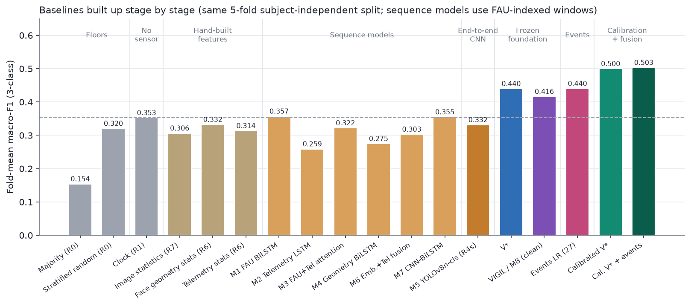

Five readings follow.

1. **Nothing conventional clears the clock.** Every rung up to and including the end-to-end CNN
   scores 0.26–0.38, within noise of a model that uses no sensor at all.
2. **Sequence models add capacity, not signal.** The best of them, the FAU BiLSTM (M1) and the
   CNN-BiLSTM on IR frames (M7), reach 0.357 and 0.355, level with the clock. Fusing modalities
   (M3, M6) scores below the better single modality. M6's frame embeddings were extracted once
   with a single fold's backbone, so its folds 1–4 are optimistic, and it still stays below the
   clock.
3. **The end-to-end CNN learns nothing that transfers.** M5 is fine-tuned per outer fold for 10
   epochs, with `best.pt` chosen on inner-validation drivers (R4s). It ties the clock (Δ −0.004,
   p = 0.95). Checkpoint selection matters: choosing `best.pt` on the test drivers instead gives
   0.449 fold-mean, which is why all selection here stays inside the training drivers.
4. **More hand-built features hurt.** Face and telemetry statistics together (0.316) score below
   either alone: more dimensions, same data.
5. **No lighting shortcut.** The image-statistics probe stays near chance, so global brightness or
   colour does not separate the classes across drivers.

About 13 training drivers and 290 labelled epochs are too little to learn features that
generalise to a new face. The bottleneck is therefore feature learning on very little labelled
data. That motivates the next rung: features learned elsewhere, kept frozen. The starting bar for
the rest of the report is the clock, about 0.36.

## 5. Methods

### 5.1 Frozen-encoder pipeline and V\* (C2)

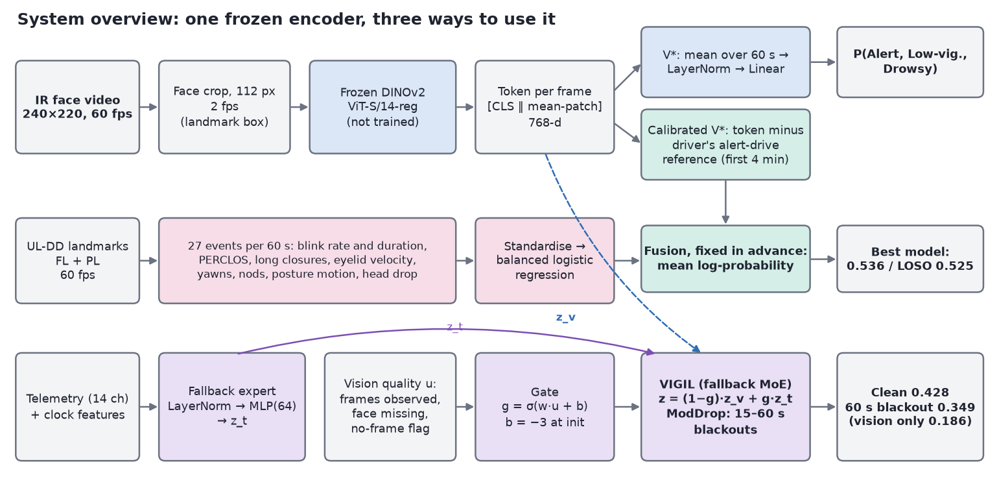

**Feature extraction.** For each video stream we sample frames at 2 fps (pose at 1 fps) and crop
the face:
- IR: from the dataset's own landmarks (1.5 × landmark extent, shifted up 8%);
- L3D / R3D: an OpenCV Haar detector with forward-fill.

Each crop goes through **DINOv2 ViT-S/14 with registers**, frozen and in fp16 on Apple MPS. We
keep the CLS token, the mean patch token and a 2×2 pooled patch grid. Models use the 768-d
[CLS ‖ mean-patch] token. Extracting all five streams for all sessions takes about an hour on the
laptop (712 images/s at 112 px).

**Heads.** A window holds up to 120 frame tokens. They are z-scored with statistics fitted on the
training rows only. We compared three heads:
- **Mean-pool:** masked mean over time, LayerNorm, dropout 0.2, then a linear layer. 3,843
  parameters.
- **Gated-attention MIL** (Ilse et al., 2018): LayerNorm, Linear to 64, GELU, gated attention
  pooling, then a linear layer.
- **Temporal transformer:** two pre-LN layers, d = 64, four heads, a CLS token and sinusoidal time
  encoding.

Training: AdamW (lr 1e-3, weight decay 0.05), one-cycle schedule, 30 epochs, class-weighted cross
entropy, 15% frame dropout and Gaussian feature noise.

**V\*** is the configuration chosen on the day-5 checkpoint and frozen thereafter: IR face at
112 px with the mean-pool head.

### 5.2 VIGIL (M8): quality-gated fallback (C3)

VIGIL, the eighth model in our sequence (M8), mixes two experts:

z = (1 − g) · z_v + g · z_t,  g = σ(w · u + b)

- **Vision expert z_v:** the V\* head on the pooled IR token.
- **Fallback expert z_t:** an MLP (LayerNorm, Linear to 64, GELU, dropout, Linear) on the window
  mean of 14 telemetry channels. The channels are pitch, roll, speed, rpm, gear, heading rate (with
  absolute value and standard deviation), Δspeed, left and right grip, grip asymmetry, a grip-zero
  flag and a telemetry-missing flag. They are multiplied by an availability flag and concatenated
  with five clock features.
- **Gate input u:** a vision-quality vector of observed-frame fraction, face-missing rate among
  observed frames and a no-frame flag. It is recomputed after any blackout.
- **Gate settings:** the gate bias starts at −3 (g ≈ 0.05), so VIGIL starts as the vision model. The
  gate uses a 10× learning rate without weight decay. Without this fast gate, the gate failed to
  open in time.
- **ModDrop training** (Neverova et al., 2016), so that the gate ever sees vision fail:
  - half of training windows get a contiguous camera blackout of 15–60 s, and a quarter of those
    are full 60 s blackouts;
  - telemetry is dropped with probability 0.1;
  - auxiliary cross-entropy losses (weight 0.5) on each expert keep both experts useful.

**Testing.** Each test window gets a blackout of L ∈ {0, 30, 45, 60} s at the same random position
for every model and seed. The comparator is the same vision model trained with the same ModDrop
but without the fallback.

VIGIL is the result of an explicit design search (C9 to C9d):
- an *ungated* additive telemetry correction;
- a *residual* gate (z = z_v + g·Δ_t), whose gate never moved, which made it cosmetic;
- MoE variants with telemetry-only or clock-only fallback experts.

The telemetry + clock MoE was chosen and frozen before the final evaluation.

### 5.3 Driver calibration and 60 fps event features (C4)

**Alert-reference calibration (P4).** For each driver, compute the mean DINOv2 token over the
first 240 s of their Alert drive. Subtract it from every token in both drives, then train and test
the V\* head on the residuals. No labels are used: in deployment the reference would come from an
enrolment drive known to be alert.

Two variants failed:
- C12 used the *same drive's* first four minutes. This removes the level signal (0.368).
- R2-8 concatenated absolute and residual tokens (0.405).

**Event features.** Every earlier model saw at most 2 fps, so blink dynamics were invisible. From
UL-DD's 60 fps landmarks we compute 27 features per window:
- **Ocular (13):** eye closure from EAR, normalised by the driver's open-eye level in the first
  4 minutes; blink rate; mean and 90th-percentile blink duration; long closures over 0.5 s;
  PERCLOS at 70%, 80% and absolute thresholds; closing and opening velocities; amplitude-velocity
  ratio; inter-blink-interval variability; EAR mean and standard deviation.
- **Mouth and head (6):** yawns (MAR > 0.6 for over 1 s), mean MAR, pitch-proxy standard deviation
  and velocity, nods, face-missing rate.
- **Posture (8):** shoulder-normalised motion energy of nose, shoulders and wrists; stillness;
  head height above the shoulders (mean, minimum, standard deviation); slouch.

A standardised, class-balanced logistic regression is trained on them. C is chosen by subject-wise
inner cross-validation.

**Fusion.** The fusion rule was fixed before any fused number was seen: average the log
probabilities of calibrated V\* and the event model, with no fitted weights.

### 5.4 Confound diagnostics (C5)

For any model's out-of-fold scores s and a binary target y (B2, or KSS ≥ 7 vs the rest):
- **Drive-AUC** is the AUC of s for separating Drowsy-drive windows from Alert-drive windows. It
  measures sensitivity to *which recording* a window comes from.
- **Within-drive AUC** is the AUC of s for y, computed only over pairs of windows from the same
  driver and drive, then pooled over drives. It measures whether the model orders sleepiness
  *inside* a recording.

We also report:
- the share of two-drive drivers whose mean prediction is higher in the Drowsy drive;
- the within-session Spearman correlation with KSS;
- the partial Spearman correlation with KSS given time-in-drive;
- matched-label comparisons.

**Subject-dependent splits.** To answer "what if the test driver's own data were in training?", V\*
is retrained under three splits:
- random windows;
- held-out whole KSS epochs, with training windows within 60 s of any test window purged;
- held-out whole drives, with the same driver's other drive in training.

Each split is compared with no-video logistic regressions on driver one-hot, session flag and
clock features.

## 6. Results

### 6.1 Single streams, heads and encoders (C2)

| Stream and head | Fold-mean | Pooled |
|---|---|---|
| **IR 112 px, mean-pool (V\*)** | **0.440** | **0.446** |
| IR 112 px, MIL | 0.410 | 0.411 |
| IR 168 px, MIL | 0.424 | 0.410 |
| IR 112 px, temporal transformer | 0.411 | 0.404 |
| IR 112 px, 240 s causal context (mean / MIL / transformer) | 0.455 / 0.444 / 0.470 | 0.451 / 0.443 / 0.458 |
| L3D face 168 px, mean / MIL | 0.332 / 0.326 | 0.378 / 0.373 |
| Pose side view 224 px, mean / MIL | 0.414 / 0.433 | 0.470 / 0.499 |
| Landmark / AU / geometry series, mean / MIL | 0.318 / 0.311 | 0.386 / 0.355 |
| IR eye crops 112 px at 10 fps, mean / MIL | 0.360 / 0.367 | 0.385 / 0.409 |
| DINOv3-S/16 instead of DINOv2 (IR 112) | 0.329 | 0.325 |
| V\* with ordinal (cumulative-logit) loss | 0.399 | 0.404 |
| Telemetry expert alone (14 channels, 4 Hz) | 0.362 | — |
| Events LR (27 features) | 0.440 | 0.480 |

- **The simplest model wins.** Longer context, attention pooling, transformers, higher resolution,
  the newer DINOv3 encoder and high-frame-rate eye crops all fail to beat a linear head on mean
  DINOv2 tokens. On 290 labelled epochs this is what the literature predicts (Section 2.4). The
  inner-validation score correlates only weakly with test (r = 0.22 over 14 runs), which is
  another reason to prefer the simplest model.
- **Pose looks strong under 5-fold but is not.** Its pooled 0.499 falls to 0.409 under LOSO. It
  also fails the session audit: balanced accuracy 0.67 for predicting the session at matched KSS
  5–6, against about chance for IR. L3D (0.73) and R3D (0.70) also carry session cues. The
  colour cameras see lighting, clothing and scene, which differ between the two recording days.
- **IR at 112 px is the most protocol-stable stream:** 5-fold 0.446, LOSO 0.471.
- **Small-data limit.** Learning-curve probes (4 → 12 → 15 training drivers: 0.365 → 0.426 →
  0.506 for a linear probe) indicate the model is data-limited. LOSO's modest gain for V\* (+0.025)
  is consistent with that.
- **Naive late fusion.** IR + telemetry with learned weights scores 0.306, and IR + pose with
  learned weights 0.405. Learning fusion weights on so few drivers overfits; equal-weight IR +
  pose reaches 0.517 pooled but was chosen after seeing test results and is reported as
  exploratory only.

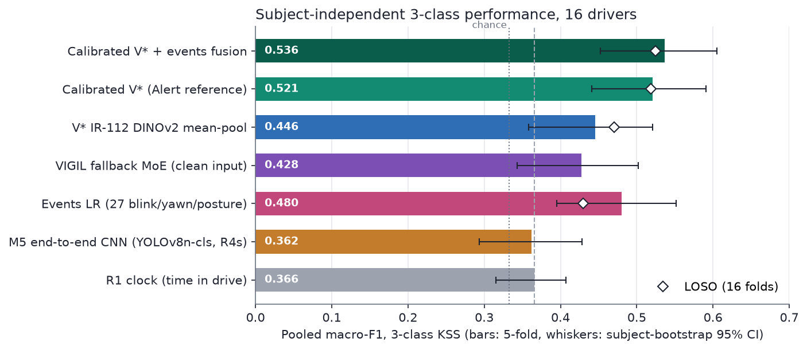

### 6.2 Robustness to camera failure (C3)

| Model | Blackout 0 s | 30 s | 45 s | 60 s (camera off) | Gate mean, 0 → 60 s |
|---|---|---|---|---|---|
| Vision only (same ModDrop training) | 0.430 | 0.433 | 0.424 | **0.186** | — |
| Residual telemetry gate (C9) | 0.435 | 0.435 | 0.423 | 0.339 | 0.12 → 0.12 |
| Clock-only residual gate | 0.435 | 0.431 | 0.427 | 0.283 | 0.11 → 0.06 |
| **VIGIL: MoE, telemetry + clock, fast gate** | **0.428** | 0.426 | 0.423 | **0.349** | **0.13 → 0.93** |

- **No harm.** On clean input VIGIL equals the vision model (H2: Δ −0.002, p = 0.80).
- **Graceful degradation.** When the camera is fully off for a window, the vision model collapses
  to 0.186, below chance for macro-F1 because it predicts one class. VIGIL keeps 0.349, close to the
  clock (H3: Δ +0.163, p = 0.076).
- **The gate is the mechanism.** It stays near 0.13 while any frames are visible and opens to 0.93
  when none are.
- **The residual design fails.** Its gate never moves, so the residual model's robustness came from
  an always-on telemetry correction, not from gating. This negative result is why VIGIL uses a
  mixture of experts.
- **What the fallback can achieve.** VIGIL's fallback performance under blackout approaches the clock
  baseline (0.366), as expected: telemetry alone is weak (0.362, about clock level) and carries little information about time-in-drive (R² = 0.04), so the fallback's strength comes mostly from its clock features.

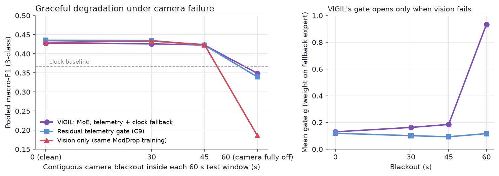

### 6.3 Calibration, events and fusion (C4)

| Model (P4 where calibrated) | 5-fold pooled [95% CI] | LOSO pooled | Epoch F1 | QWK | Partial ρ (KSS given time) | vs clock Δ (p) |
|---|---|---|---|---|---|---|
| Clock (R1) | 0.366 [0.32, 0.41] | — | 0.369 | 0.19 | +0.04 | — |
| M5 / R4s (end-to-end CNN) | 0.362 [0.29, 0.43] | — | 0.363 | 0.27 | +0.35 | −0.004 (0.95) |
| V\* | 0.446 [0.36, 0.52] | 0.471 | 0.440 | 0.13 | +0.17 | +0.079 (0.31) |
| Events LR | 0.480 [0.40, 0.55] | 0.430 | 0.507 | 0.16 | +0.12 | +0.114 (0.07) |
| VIGIL (clean) | 0.428 [0.34, 0.50] | — | 0.419 | 0.15 | +0.20 | +0.062 (0.43) |
| Calibrated V\* | 0.521 [0.44, 0.59] | 0.518 | 0.540 | **0.52** | **+0.63** | +0.155 (**0.01**) |
| **Calibrated V\* + events** | **0.536** [0.45, 0.61] | **0.525** | **0.545** | 0.52 | +0.63 | +0.170 (**<0.01**) |

- **Calibration is the largest single gain:** +0.075 over V\* (H4, p = 0.18), with the same level
  under LOSO.
- **Ordinal structure improves sharply.** QWK goes from 0.13 to 0.52, and Alert↔Drowsy confusions
  nearly vanish (see the confusion matrices below).
- **Interpretable events match the foundation model.** Events alone score 0.480 (0.430 under LOSO)
  and fuse well with calibrated V\*.
- **Only the calibrated models beat the clock significantly.** They are also the only ones whose
  predictions track KSS beyond time-in-drive (partial ρ 0.63).

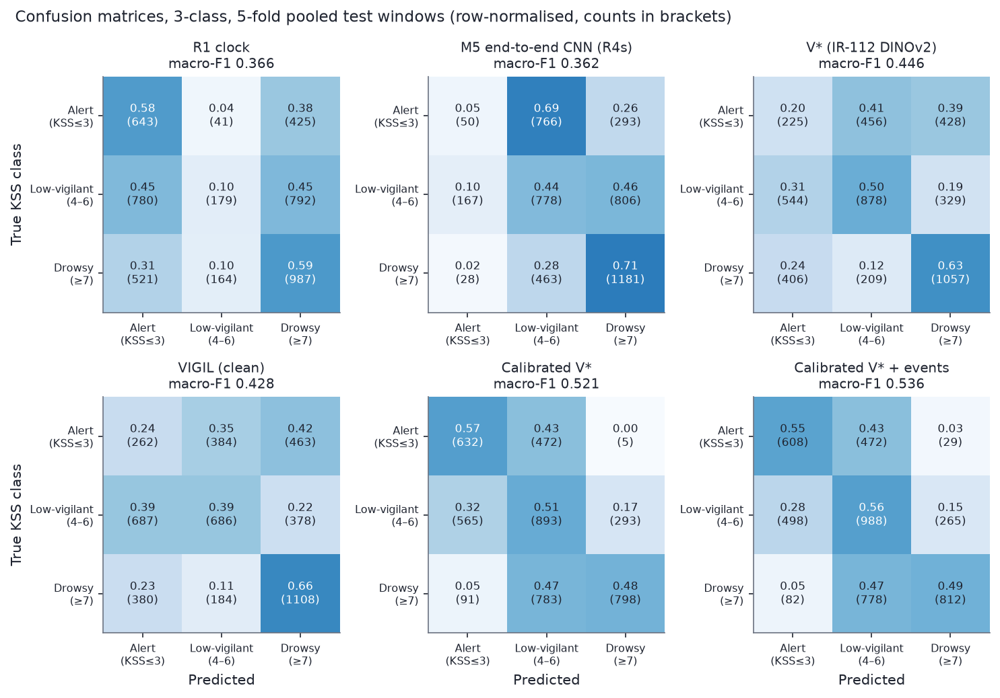

The confusion matrices show the characteristic pattern:
- The clock and the end-to-end CNN cannot recognise Alert.
- V\* spreads errors across all cells.
- The calibrated models separate Alert from Drowsy almost perfectly (0–3% Alert→Drowsy), but
  confuse adjacent classes. They predict half of the Drowsy windows as Low-vigilant.

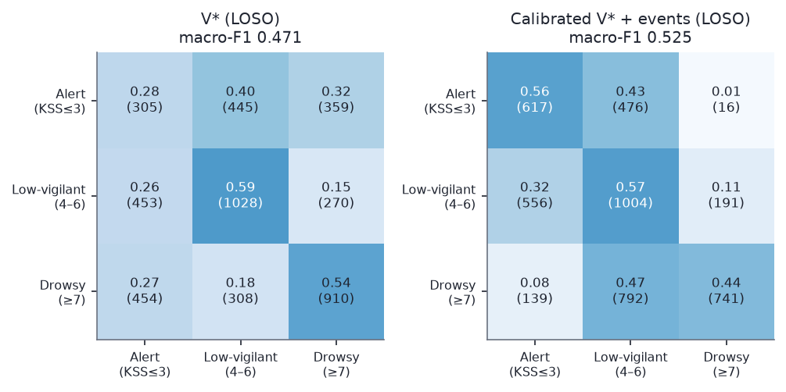

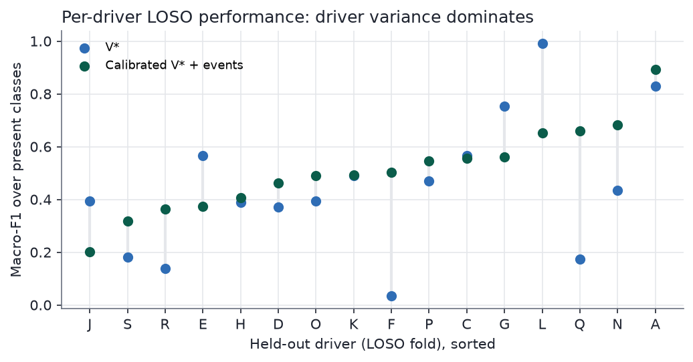

**Drivers vary more than models do.** Per-driver LOSO F1 for V\* ranges from 0.03 to 0.99. The calibrated
fusion helps most where V\* fails completely (F, Q, R) and hurts on some drivers where V\* was best
(L, G, J).

### 6.4 Binary labels

On B2 (KSS ≤ 5 vs ≥ 6):

| Model | Pooled F1 | AUC |
|---|---|---|
| Clock | 0.570 | 0.56 |
| V\* | 0.569 | 0.58 |
| Pose MIL | 0.550 | 0.62 |
| Events | 0.561 | 0.59 |
| VIGIL | 0.577 | 0.60 |
| **Calibrated V\*** | **0.775** (LOSO 0.779) | **0.86** |

The calibrated number looks like a breakthrough, but Section 7 shows it is mostly detection of the
drive. We report it only together with its within-drive AUC.

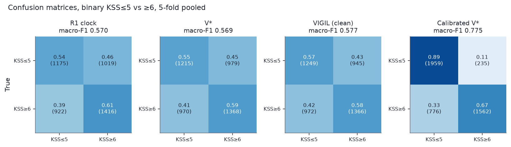

### 6.5 Pre-registered hypotheses

Exact subject-level permutation tests with Holm correction:

| Hypothesis | Δ pooled F1 | p | Holm-adjusted p |
|---|---|---|---|
| H1: V\* > end-to-end CNN (R4s) | +0.084 | 0.152 | 0.456 |
| H2: VIGIL does no harm (clean) | −0.002 | 0.802 | 0.802 |
| H3: VIGIL > vision-only, 60 s blackout | +0.163 | 0.076 | 0.306 |
| H4: calibrated > uncalibrated V\* | +0.075 | 0.177 | 0.456 |

None is significant after correction. With 16 drivers and driver-level variance as large as shown
in the per-driver figure above, the test has low power for effects below about 0.15 F1. We report the effect sizes
and confidence intervals, and do not claim significance.

## 7. What do the models actually detect? (C5)

### 7.1 Drive-level vs within-drive signal

In UL-DD the Alert and Drowsy drives were recorded on different occasions, and their labels
barely overlap:
- B2 equals "is this the Drowsy drive" for 91% of windows;
- 67% of KSS variance lies between the two drives.

A model can therefore score well by recognising the recording. The figure below places every model on two axes.

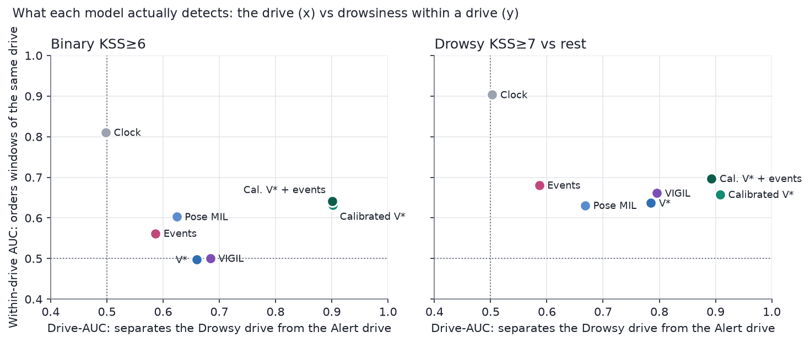

| Model | B2 within-drive AUC | B2 drive-AUC | KSS ≥ 7 within-drive AUC | KSS ≥ 7 drive-AUC |
|---|---|---|---|---|
| Clock | **0.81** | 0.50 | **0.90** | 0.50 |
| V\* | 0.50 | 0.66 | 0.64 | 0.79 |
| Pose MIL | 0.60 | 0.62 | 0.63 | 0.67 |
| Events | 0.56 | 0.59 | 0.68 | 0.59 |
| VIGIL | 0.50 | 0.68 | 0.66 | 0.80 |
| Calibrated V\* | 0.63 | **0.90** | 0.66 | **0.91** |
| Calibrated V\* + events | 0.64 | 0.90 | 0.70 | 0.89 |

Three readings follow.

1. **Within a drive, time beats vision.** Sleepiness rises almost monotonically within each drive,
   and the clock orders it with AUC 0.81–0.90. No vision model exceeds 0.72.
2. **Vision gains over the clock are drive-level.** The calibrated models separate the drives at
   AUC 0.90. At the same true label (KSS ≥ 6), calibrated V\* gives Alert-drive windows P(drowsy)
   = 0.23 and Drowsy-drive windows 0.70. Plain V\* gives 0.26 and 0.64. Referencing the Alert
   drive makes "this is a different recording" easy to see.
3. **Calibration still adds some genuine within-drive signal.** B2 within-drive AUC rises from 0.50
   to 0.63–0.66. Events are the least drive-sensitive model (drive-AUC 0.59).

Adding the clock to the fused model, an exploratory post-hoc check, gives 0.559 (p = 0.04). The
two signals are complementary but small at the decision level.

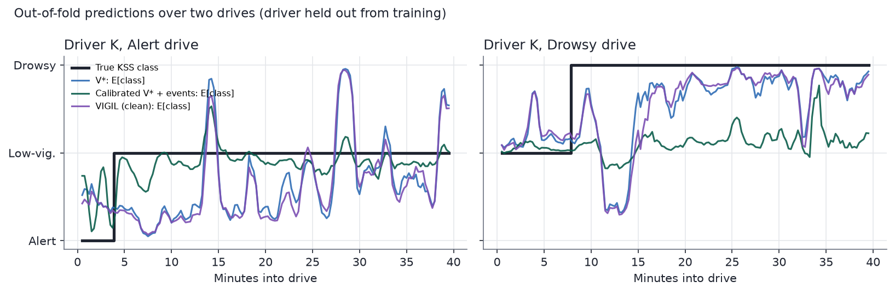

### 7.2 What if the test driver were in training?

A natural question is whether splitting each driver's data between training and test would raise
the score. It does, but for the wrong reason.

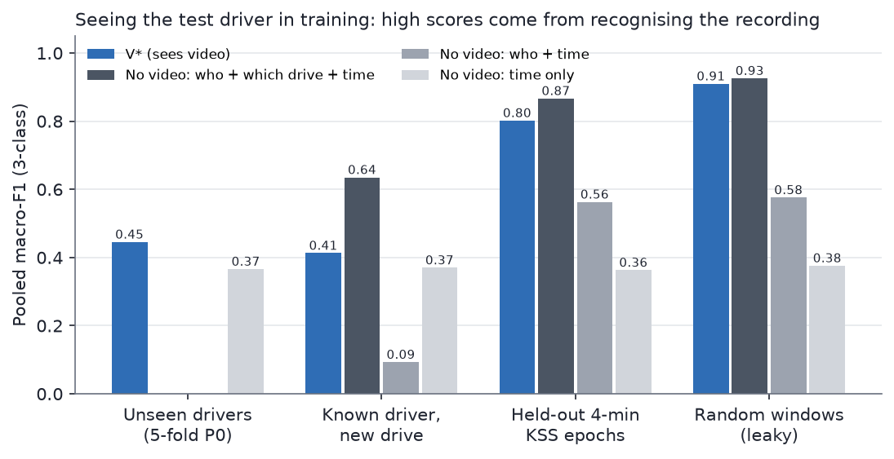

| Split | V\* | No video: who + drive + time | Who + time | Time only |
|---|---|---|---|---|
| Unseen drivers (P0) | 0.446 | — | — | 0.366 |
| Random windows (75% frame overlap with neighbours) | 0.910 | **0.926** | 0.576 | 0.376 |
| Held-out 4-minute epochs, 60 s purge | 0.802 | **0.867** | 0.563 | 0.363 |
| **Known driver, new drive** | **0.413** | 0.635 | 0.093 | 0.370 |

- **Random and epoch splits measure recording recognition.** A model that sees no video and only
  knows the driver, the drive and the time scores *higher* than V\*. Because KSS is nearly a smooth
  function of time within a drive, seeing any part of a drive gives away the rest.
- **The realistic known-driver case is worse than unseen drivers.** With the driver's other drive
  in training, V\* scores 0.413, below 0.446 for unseen drivers. Training on the other drive teaches
  "this face corresponds to that drive's KSS level", which is wrong for the new drive. The who +
  time model collapses to 0.093.
- **Implication.** The 90%+ accuracies reported with within-subject splits on similar data should
  be read as recording recognition until shown otherwise.

## 8. System and demo (C6)

- **Compute.** Everything runs on a MacBook with an Apple M4 and 16 GB of memory, using MPS:
  - DINOv2 extraction for all streams takes about an hour;
  - a head trains in 1–2 minutes;
  - the full final evaluation took about 2.5 hours.
- **Deployment models.** `scripts/m8/train_final.py` refits V\*, calibrated V\*, VIGIL and the event
  model on all 16 drivers and saves them to `models/final/`. Each is 5–80 KB; DINOv2 is loaded from
  timm.
- **Inference.** `m8/inference.py` supports two paths:
  - A UL-DD session, using cached tokens, telemetry and event features. All five model outputs,
    and an optional simulated blackout, take about 2 s.
  - An uploaded IR face video. Faces are found with OpenCV's Haar detector, with the box mapped to
    the landmark framing (side = 1.18 × Haar width, fitted on 268 frames) and median-smoothed.
    Frames are encoded at 2 fps and scored with V\* and, given an alert reference video,
    calibrated V\*.
  - On UL-DD video the two paths agree on 69% of V\* window decisions, because the crops differ.
- **Demo.** `app/demo.py` is a Gradio application with three tabs:
  - **Replay:** any UL-DD drive with honest out-of-fold or deployment predictions, the IR frame
    and model input at any minute, per-model probabilities, and VIGIL's gate under simulated
    blackouts.
  - **Upload:** a video upload path.
  - **Results:** headline results and figures.

## 9. Discussion and limitations

**What the numbers mean.** The best calibration-free model scores 0.446–0.471 pooled macro-F1 on
three-class KSS for unseen drivers. With four unlabelled alert minutes it scores 0.518–0.536.
These sit at the lower end of the literature's realistic targets for naturalistic three-class KSS
(0.50–0.55 calibration-free, about 0.60–0.65 with calibration) and well above every
conventional baseline in Section 4. The confound analysis tempers them: most of what separates these models from the clock is
drive-level.

**Why drive-level signal is not simply a bug.** The Drowsy drive *is* sleepier, and a deployed
system that recognises "this driver looks different from their alert baseline" is doing something
useful. The concern is what else differs between drives. A real deployment calibrated on an
enrolment drive would see new lighting, clothing or seating, and could mistake them for
drowsiness. UL-DD cannot separate these causes, because each driver has only one drive per state.

**Limitations.**
- **Small n.** There are 16 drivers and 290 labelled epochs. Confidence intervals are wide, no
  hypothesis survives Holm correction, and driver-to-driver variance (F1 0.03–0.99) dominates.
- **Label resolution.** One self-report every 4 minutes, inherited by about 16 overlapping
  windows. The Alert/Low-vigilant boundary is subjective.
- **Simulator data.** It may not transfer to real cabins, lighting and head motion.
- **The P4 assumption.** Calibration needs a known-alert reference from the same driver.
- **Upload-path domain shift.** The demo's upload path uses a different face detector from
  training.
- **Unused information.** We did not use physiology (by design), stereo depth (calibration not
  released) or fine-tuned encoders (overfitting risk at this n).

**Recommendations for work on similar datasets.**
- Report a time-in-drive baseline.
- Report LOSO next to k-fold.
- Report drive-AUC and within-drive AUC next to any headline.
- Keep all model selection inside the training drivers.
- Treat within-subject splits as recognition benchmarks, not drowsiness benchmarks.

## 10. Conclusion and future work

We built driver drowsiness detection on UL-DD from the ground up under strictly
subject-independent evaluation. The honest bar was the time-in-drive clock (about 0.36):
hand-built statistics and an end-to-end CNN did not clear it.

- **Better features.** Frozen DINOv2 features on low-resolution IR face crops with a 3,843-parameter
  head clear it: 0.446, LOSO 0.471.
- **Calibration and events.** An unlabelled four-minute alert reference and interpretable 60 fps
  events raise it to 0.536 / 0.525. These are the only models that significantly beat the clock.
- **Robustness.** A quality-gated mixture of experts keeps the system near clock level when the
  camera fails, instead of collapsing.
- **The confound.** Separating drive-level from within-drive signal shows that much of what every
  model learns is which drive it is watching. Within a drive, time-on-task remains the strongest
  predictor.

**Future work.**
- Data with several drives per state per driver, to separate sleepiness from recording conditions.
- Denser labels (observer ratings or PVT) to train within-drive dynamics.
- Self-supervised adaptation on unlabelled video from new drivers.
- Explicitly combining drive-level appearance with time-on-task and event dynamics in a temporal
  model whose within-drive AUC is the optimisation target.
- Validating the fallback on real camera failures in vehicles.

## References

- Bodaghi, M., Hosseini, M., Gottumukkala, R., Bhupatiraju, R., Ahmad, I., Gabbouj, M. UL-DD: A
  multimodal drowsiness dataset using video, biometric signals, and behavioral data.
  arXiv:2507.13403 (2025); *Scientific Data* (2026), doi:10.1038/s41597-025-06540-1.
- Kavipriya R. Driver drowsiness detection on UL-DD. MTech project report (2025).
- ildahun. Multimodal driver fatigue detection on UL-DD. MSc thesis code (2025),
  github.com/ildahun/Driver-Drowsiness-Detection.
- Oquab, M. et al. DINOv2: Learning robust visual features without supervision. *TMLR* (2024),
  arXiv:2304.07193.
- Siméoni, O. et al. DINOv3. arXiv:2508.10104 (2025).
- Ilse, M., Tomczak, J., Welling, M. Attention-based deep multiple instance learning. *ICML* (2018).
- Neverova, N. et al. ModDrop: Adaptive multi-modal gesture recognition. *TPAMI* (2016),
  arXiv:1501.00102.
- Alayrac, J.-B. et al. Flamingo: A visual language model for few-shot learning. arXiv:2204.14198
  (2022).
- Zhang, Q. et al. Provable dynamic fusion for low-quality multimodal data (QMF). *ICML* (2023).
- Wang, W., Tran, D., Feiszli, M. What makes training multi-modal classification networks hard?
  *CVPR* (2020).
- Peng, X. et al. Balanced multimodal learning via on-the-fly gradient modulation. *CVPR* (2022).
- Wu, N. et al. Characterizing and overcoming the greedy nature of learning in multi-modal deep
  neural networks. *ICML* (2022).
- Ma, M. et al. Are multimodal transformers robust to missing modality? *CVPR* (2022).
- Kumar, A. et al. Fine-tuning can distort pretrained features and underperform out-of-distribution.
  *ICLR* (2022).
- Ghoddoosian, R., Galib, M., Athitsos, V. A realistic dataset and baseline temporal model for early
  drowsiness detection. *CVPR Workshops* (2019).
- Wolter, et al. Blinking beyond EAR. arXiv:2511.19519 (2025).
- Massoz, Q., Verly, J., Van Droogenbroeck, M. Multi-timescale drowsiness characterization based on
  a video of a driver's face. *Sensors* 18(9):2801 (2018).
- Lakhani, A. Spatiotemporal attention with vision transformers for drowsiness detection.
  arXiv:2207.12148 (2022).
- Hassan, et al. Real-time driver drowsiness detection using transformer architectures. *Scientific
  Reports* 15:17493 (2025).
- Kim, J., Choi, S. STFTransNet. *Sensors* 25(18):5819 (2025).
- Tüfekci, G. et al. Detecting driver drowsiness as an anomaly using LSTM autoencoders. *ECCV
  Workshops* (2022).
- Madaan, D. et al. Jointly modeling inter- and intra-modality dependencies (I2M2). *NeurIPS* (2024).

## Appendix A. Reproduction

All commands use `/opt/anaconda3/envs/ddd-repo/bin/python` from the repository root.

1. Windows and folds: `python -m m8.windows`
2. Features:
   - `python -m m8.extract --stream ir --px 112` (and the other streams);
   - `python -m m8.tabular`;
   - `python -m m8.events`.
3. Baselines:
   - `scripts/m8/r0_r1_baselines.py`, `r6_tabular.py`, `r7_image_stats_probe.py`;
   - `scripts/m8/r4_m5_honest.py` (end-to-end CNN), then `score_frame_run.py`;
   - sequence models: `scripts/m1/` to `scripts/m7/` (`train_m*.py`).
4. V\* and ablations: `scripts/m8/run_single_stream.py --stream ir_112 --head mean` (add
   `--protocol loso`, `--ref 240 --ref-session A` and `--y y_b2` for the variants).
5. VIGIL: `scripts/m8/run_vigil.py --modes moe_telclock vision --gate-lr-mult 10`.
6. Final evaluation:
   - `scripts/m8/fusion_calib_events.py`;
   - `scripts/m8/final_metrics.py`;
   - `scripts/m8/subject_dependent.py --split {random,epoch,drive}`.
7. Figures: `scripts/m8/make_figures.py`, written to `results/figures/`.
8. Deployment and demo:
   - `scripts/m8/train_final.py`;
   - `python -m m8.inference --session K D`;
   - `python app/demo.py`.

Per-run JSON results are in `results/m8/`; every run is also logged to Weights & Biases (project
`drowsiness_project`).

## Appendix B. Model glossary

| ID | Description |
|---|---|
| M1–M4, M6, M7 | Sequence-model baselines: FAU BiLSTM, telemetry LSTM, FAU + telemetry attention, geometry BiLSTM, embedding + telemetry fusion, CNN-BiLSTM |
| M5 | End-to-end CNN on IR frames (YOLOv8n-cls); reported as R4s with inner-validation checkpoints |
| R0 | Majority and stratified-random floors |
| R1 | Clock: logistic regression on time-in-drive and epoch index |
| R4s | End-to-end CNN: YOLOv8n-cls fine-tuned on IR frames, inner-validation checkpoints, 3-seed ensemble |
| R6 | Hand-built face-geometry and telemetry window statistics, logistic regression |
| R7 | Image-statistics probe (brightness, colour moments, histograms) |
| V\* | Frozen DINOv2-S/14-reg on IR 112 px face at 2 fps, mean-pool linear head |
| Calibrated V\* (P4) | V\* on tokens minus the driver's Alert-drive 240 s reference |
| Events LR | 27 features from 60 fps landmarks, logistic regression |
| VIGIL (M8) | MoE of the V\* vision expert and a telemetry + clock expert, vision-quality gate, ModDrop |
| B2 | Binary label, KSS ≤ 5 vs ≥ 6 |
| P0 / V1 / P4 | 5-fold subject-independent / LOSO / with alert reference |
